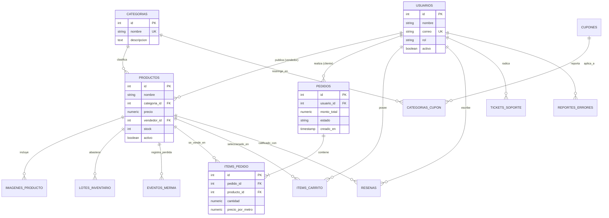
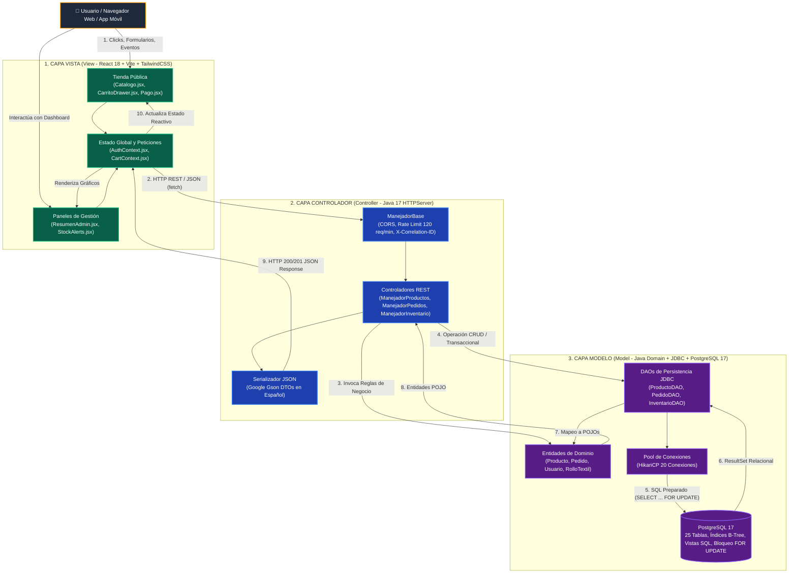
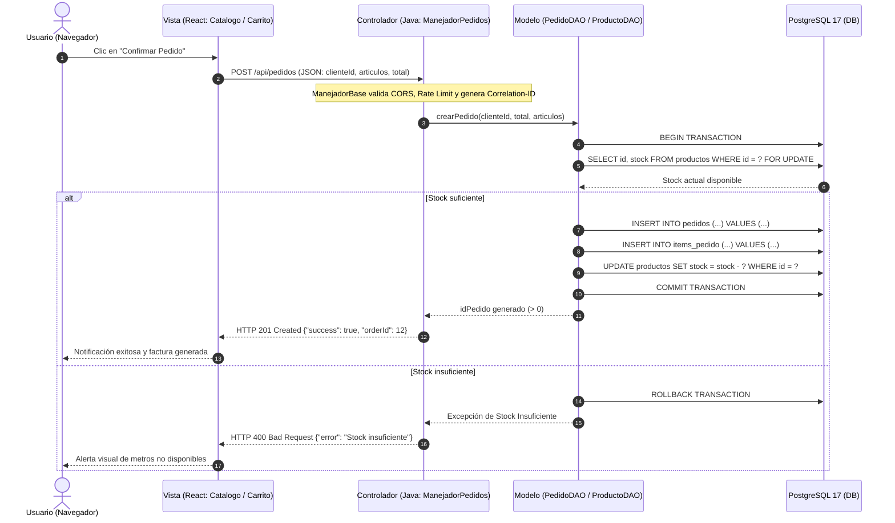

# Documentación Técnica de Base de Datos y Arquitectura MVC
**Proyecto:** Plataforma Digital de Telas y Control Logístico (D&D Textil)  
**Programa de Formación:** Tecnólogo en Análisis y Desarrollo de Software (ADSO) - SENA  
**Motor de Base de Datos:** PostgreSQL 17 (UTF-8)  
**Patrón Arquitectónico:** Modelo-Vista-Controlador (MVC) / Arquitectura Limpia  
**Versión:** 2.0.0 Oficial SENA  

---

## 1. Estructura del Directorio `BASE DE DATOS/`

Este directorio contiene los artefactos de inicialización, definición DDL, datos semilla y respaldos de la base de datos relacional para el entorno productivo y de desarrollo:

* **`01_esquema_espanol.sql`**: Script DDL principal que define las 25 tablas relacionales en español, sus restricciones de integridad (`PRIMARY KEY`, `FOREIGN KEY`, `UNIQUE`, `CHECK`), valores por defecto y tipos de datos numéricos de alta precisión para textiles y moneda.
* **`02_datos_iniciales.sql`**: Script DML con datos iniciales para categorías textiles, telas base de alta rotación, usuarios con roles tipificados (Administrador, Vendedor, Cliente), métricas y configuración global del sistema.
* **`TIENDA DIGITAL TEXTIL.sql`**: Respaldo consolidado de estructura y datos históricos para auditoría y restauración rápida.
* **`README.md`**: Este documento de especificación formal del **Modelo Relacional** y el patrón **Modelo-Vista-Controlador (MVC)**.

---

## 2. Modelo Relacional Formal

El modelo de datos relacional de **D&D Textil** se encuentra normalizado hasta la **Tercera Forma Normal (3FN)**, eliminando redundancias atómicas y dependencias transitivas. Permite modelar el negocio textil con trazabilidad de compras por metro lineal, inventario fraccionado, alertas de stock mínimo y órdenes de pedido.

### 2.1. Diagrama Gráfico Vectorial del Modelo Relacional

A continuación se presenta el **esquema gráfico completo** de las 25 tablas relacionales organizadas por clústeres de negocio (Catálogo Textil, Usuarios y Seguridad, Ventas y Transacciones, Cupones y Métricas ERP), detallando claves primarias (PK en amarillo), claves foráneas (FK en celeste), restricciones únicas (UK en violeta) y líneas de integridad referencial:


> **Nota:** Puedes hacer clic o abrir directamente el archivo vectorial en alta definición: [modelo_relacional.svg](diagramas/modelo_relacional.svg).

---

### 2.2. Notación Formal del Esquema Relacional

En la notación relacional, cada tabla se define con su nombre, atributos, claves primarias (**PK**) subrayadas y claves foráneas (**FK**) con indicación de la tabla referenciada:

1. **`CATEGORIAS`**  
   `CATEGORIAS(`<u>`id`</u>, `nombre` [UK], `descripcion`, `creado_en`)

2. **`USUARIOS`**  
   `USUARIOS(`<u>`id`</u>, `nombre`, `correo` [UK], `contrasena_hash`, `rol`, `activo`, `suspendido`, `motivo_suspension`, `tasa_comision`, `registrado_en`, `ultimo_acceso`)

3. **`PRODUCTOS`**  
   `PRODUCTOS(`<u>`id`</u>, `nombre`, `categoria_id` [FK &rarr; `CATEGORIAS.id`], `precio`, `vendedor_id` [FK &rarr; `USUARIOS.id`], `descripcion`, `material`, `ancho`, `peso`, `cuidados`, `stock`, `destacado`, `activo`, `estado_moderacion`, `motivo_rechazo`, `es_nueva_coleccion`, `es_exclusivo`, `es_oferta`, `creado_en`, `actualizado_en`)

4. **`IMAGENES_PRODUCTO`**  
   `IMAGENES_PRODUCTO(`<u>`id`</u>, `producto_id` [FK &rarr; `PRODUCTOS.id`], `url_imagen`, `orden_visualizacion`)

5. **`LOTES_INVENTARIO`**  
   `LOTES_INVENTARIO(`<u>`id`</u>, `producto_id` [FK &rarr; `PRODUCTOS.id`], `numero_lote`, `metros_recibidos`, `costo_por_metro`, `proveedor`, `fecha_recepcion`, `notas`, `creado_en`)

6. **`EVENTOS_MERMA`**  
   `EVENTOS_MERMA(`<u>`id`</u>, `producto_id` [FK &rarr; `PRODUCTOS.id`], `metros_perdidos`, `motivo`, `impacto_costo`, `creado_en`)

7. **`UMBRALES_STOCK`**  
   `UMBRALES_STOCK(`<u>`id`</u>, `tipo_tela` [UK], `metros_minimos`, `alerta_activa`)

8. **`CUPONES`**  
   `CUPONES(`<u>`id`</u>, `codigo` [UK], `code`, `tipo_descuento`, `valor_descuento`, `expira_en`, `compra_minima`, `usos_maximos`, `solo_primera_vez`, `conteo_usos`, `activo`, `active`, `creado_en`)

9. **`CATEGORIAS_CUPON`**  
   `CATEGORIAS_CUPON(`<u>`id`</u>, `cupon_id` [FK &rarr; `CUPONES.id`], `categoria_id` [FK &rarr; `CATEGORIAS.id`])

10. **`PEDIDOS`**  
    `PEDIDOS(`<u>`id`</u>, `usuario_id` [FK &rarr; `USUARIOS.id`], `vendedor_id` [FK &rarr; `USUARIOS.id`], `nombre_cliente`, `correo_cliente`, `telefono_cliente`, `direccion_envio`, `ciudad_envio`, `departamento_envio`, `monto_total`, `subtotal`, `monto_impuesto`, `costo_envio`, `monto_descuento`, `codigo_cupon`, `estado`, `metodo_pago`, `estado_pago`, `numero_guia`, `notas`, `creado_en`, `actualizado_en`)

11. **`ITEMS_PEDIDO`**  
    `ITEMS_PEDIDO(`<u>`id`</u>, `pedido_id` [FK &rarr; `PEDIDOS.id`], `producto_id` [FK &rarr; `PRODUCTOS.id`], `cantidad`, `precio_por_metro`, `subtotal`)

12. **`ITEMS_CARRITO`**  
    `ITEMS_CARRITO(`<u>`id`</u>, `usuario_id` [FK &rarr; `USUARIOS.id`], `producto_id` [FK &rarr; `PRODUCTOS.id`], `cantidad`, `agregado_en`, `actualizado_en`)

13. **`RESENAS`**  
    `RESENAS(`<u>`id`</u>, `producto_id` [FK &rarr; `PRODUCTOS.id`], `usuario_id` [FK &rarr; `USUARIOS.id`], `calificacion`, `comentario`, `creado_en`)

14. **`TICKETS_SOPORTE`**  
    `TICKETS_SOPORTE(`<u>`id`</u>, `usuario_id` [FK &rarr; `USUARIOS.id`], `nombre_usuario`, `correo_usuario`, `asunto`, `descripcion`, `estado`, `prioridad`, `asignado_a` [FK &rarr; `USUARIOS.id`], `creado_en`, `actualizado_en`, `resuelto_en`)

15. **`REPORTES_ERRORES`**  
    `REPORTES_ERRORES(`<u>`id`</u>, `vendedor_id` [FK &rarr; `USUARIOS.id`], `nombre_vendedor`, `area`, `descripcion`, `pasos`, `estado`, `prioridad`, `asignado_a` [FK &rarr; `USUARIOS.id`], `reportado_en`, `resuelto_en`)

16. **`CONFIGURACION_SISTEMA`**  
    `CONFIGURACION_SISTEMA(`<u>`id`</u>, `clave` [UK], `valor`, `actualizado_en`)

17. **`SECCIONES_INICIO`**  
    `SECCIONES_INICIO(`<u>`id`</u>, `clave` [UK], `titulo`, `subtitulo`, `activo`, `orden`, `creado_en`, `active`)

18. **`DIAPOSITIVAS_CARRUSEL`**  
    `DIAPOSITIVAS_CARRUSEL(`<u>`id`</u>, `titulo`, `subtitulo`, `imagen`, `cta`, `clave_seccion`, `activo`, `orden`, `creado_en`, `image`, `active`)

19. **`BANNER_GLOBAL`**  
    `BANNER_GLOBAL(`<u>`id`</u>, `activo`, `mensaje`, `tipo_banner`, `actualizado_en`)

20. **`METRICAS_VENTAS_ERP`**  
    `METRICAS_VENTAS_ERP(`<u>`id`</u>, `fecha_registro` [UK], `ventas_reales`, `ventas_objetivo`, `margen_ganancia`, `creado_en`)

21. **`VENTAS_DIARIAS`**  
    `VENTAS_DIARIAS(`<u>`id`</u>, `fecha_venta` [UK], `ventas_totales`, `pedidos_totales`, `creado_en`)

22. **`VENTAS_REGION`**  
    `VENTAS_REGION(`<u>`id`</u>, `region`, `ventas_totales`, `porcentaje`, `creado_en`)

23. **`ACTIVIDAD_RECIENTE`**  
    `ACTIVIDAD_RECIENTE(`<u>`id`</u>, `tipo`, `usuario_id` [FK &rarr; `USUARIOS.id`], `nombre_usuario`, `accion`, `creado_en`)

24. **`NOTIFICACIONES_SISTEMA_ERP`**  
    `NOTIFICACIONES_SISTEMA_ERP(`<u>`id`</u>, `tipo`, `titulo`, `mensaje`, `leido`, `creado_en`, `type`)

25. **`INVENTARIO_TELAS_ERP`**  
    `INVENTARIO_TELAS_ERP(`<u>`id`</u>, `sku` [UK], `nombre_tela`, `categoria`, `proveedor`, `metros_actuales`, `metros_minimos`, `costo_por_metro`, `fecha_ultima_reposicion`)

---

### 2.2. Diagrama Entidad-Relación (DER)



---

### 2.3. Vistas de Base de Datos (SQL Views)

En PostgreSQL, las **Vistas** encapsulan consultas complejas de agregación, uniones frecuentes y reportes de auditoría, mejorando el desacoplamiento con el backend:

#### Vista 1: Catálogo Consolidado de Telas con Imágenes
```sql
CREATE OR REPLACE VIEW vista_catalogo_telas AS
SELECT 
    p.id AS producto_id,
    p.nombre AS nombre_tela,
    c.nombre AS categoria,
    p.precio,
    p.stock AS metros_disponibles,
    p.material,
    p.ancho,
    u.nombre AS vendedor,
    (SELECT ip.url_imagen 
     FROM imagenes_producto ip 
     WHERE ip.producto_id = p.id 
     ORDER BY ip.orden_visualizacion ASC LIMIT 1) AS imagen_principal,
    COALESCE(AVG(r.calificacion), 5.0) AS calificacion_promedio,
    COUNT(r.id) AS total_resenas
FROM productos p
JOIN categorias c ON p.categoria_id = c.id
LEFT JOIN usuarios u ON p.vendedor_id = u.id
LEFT JOIN resenas r ON p.id = r.producto_id
WHERE p.activo = true AND p.estado_moderacion = 'approved'
GROUP BY p.id, c.nombre, u.nombre;
```

#### Vista 2: Alertas de Stock Crítico de Inventario
```sql
CREATE OR REPLACE VIEW vista_alertas_stock_critico AS
SELECT 
    p.id AS producto_id,
    p.nombre AS nombre_tela,
    p.stock AS metros_actuales,
    COALESCE(u.metros_minimos, 20.0) AS umbral_minimo,
    CASE 
        WHEN p.stock <= 0 THEN 'AGOTADO'
        WHEN p.stock <= COALESCE(u.metros_minimos, 20.0) THEN 'CRITICO'
        ELSE 'OPTIMO'
    END AS estado_alerta
FROM productos p
LEFT JOIN umbrales_stock u ON p.nombre = u.tipo_tela OR p.material = u.tipo_tela
WHERE p.activo = true;
```

#### Vista 3: Resumen de Ventas por Vendedor
```sql
CREATE OR REPLACE VIEW vista_ventas_vendedores AS
SELECT 
    u.id AS vendedor_id,
    u.nombre AS vendedor_nombre,
    u.correo AS vendedor_correo,
    COUNT(DISTINCT p.id) AS total_pedidos,
    COALESCE(SUM(ip.subtotal), 0.00) AS total_ventas,
    COALESCE(SUM(ip.subtotal * (u.tasa_comision / 100.0)), 0.00) AS comisiones_acumuladas
FROM usuarios u
LEFT JOIN pedidos p ON p.vendedor_id = u.id AND p.estado NOT IN ('cancelled', 'refunded')
LEFT JOIN items_pedido ip ON ip.pedido_id = p.id
WHERE u.rol = 'vendedor'
GROUP BY u.id, u.nombre, u.correo;
```

---

## 3. Arquitectura Modelo-Vista-Controlador (MVC)

El sistema **D&D Textil** implementa una variante robusta y desacoplada del patrón arquitectónico **Modelo-Vista-Controlador (MVC)**, adecuada para plataformas web modernas y aplicaciones distribuidas (ADSO - SENA).

### 3.1. Diagrama Gráfico Vectorial de la Arquitectura MVC

El siguiente diagrama visual ilustra la arquitectura de tres capas, los componentes de software de cada capa, los canales de comunicación HTTP REST/JSON y JDBC, y el flujo de datos transaccional:


> **Nota:** Puedes hacer clic o abrir directamente el archivo vectorial en alta definición: [arquitectura_mvc.svg](diagramas/arquitectura_mvc.svg).

---

### 3.2. Diagrama de Flujo Arquitectónico MVC (Interacción entre Capas)



---

### 3.1. Componente M: El Modelo (Model)

El **Modelo** es el núcleo de la lógica de negocio y la persistencia de datos. Contiene los datos puros, las reglas de integridad y el acceso a la base de datos:

1. **Persistencia Relacional (PostgreSQL 17):**
   * Almacenamiento seguro, índices B-Tree de alto rendimiento, transacciones ACID y bloqueos a nivel de fila (`SELECT ... FOR UPDATE`) para evitar condiciones de carrera en compras simultáneas de tela.
2. **Entidades de Dominio (`dominio.modelos.*`):**
   * Clases Java encapsuladas (`Producto`, `Pedido`, `Usuario`, `ItemCarrito`, `LoteInventario`, `UmbralStock`, `VentaRegion`, `ActividadReciente`).
   * Manejo bilingüe con anotaciones `@SerializedName` de Google Gson para serialización transparente.
3. **Objetos de Acceso a Datos (`infraestructura.persistencia.jdbc.*`):**
   * DAOs especializados (`ProductoDAO`, `PedidoDAO`, `InventarioDAO`, `CarritoDAO`, `UsuarioDAO`, `CuponDAO`).
   * Consultas SQL parametrizadas mediante `PreparedStatement` para mitigar ataques de inyección SQL (OWASP Top 10).

---

### 3.2. Componente V: La Vista (View)

La **Vista** es la interfaz visual reactiva con la que interactúan los diferentes actores del sistema (Clientes, Vendedores, Administradores):

1. **Frontend React 18 + Vite:**
   * Estructura SPA (Single Page Application) modular y desacoplada del backend.
   * Estilizado con Tailwind CSS bajo principios de ergonomía visual y accesibilidad (WCAG 2.1).
2. **Componentes Clave de Vista:**
   * `src/paginas/Catalogo.jsx`: Renderizado del catálogo textil con filtros dinámicos por tipo de tela y precio.
   * `src/componentes/CarritoDrawer.jsx`: Carrito lateral interactivo con cálculo automático de totales y cupones.
   * `src/paginas/admin/ResumenAdmin.jsx`: Panel de control con gráficos Recharts para métricas comerciales.
   * `src/paginas/admin/Inventario/ConfiguracionStock.jsx`: Vista de configuración de umbrales y alertas de stock.
3. **Consumo Desacoplado:**
   * La Vista no accede jamás de forma directa a la base de datos; delega toda obtención de información mediante peticiones asíncronas `fetch()` hacia la API REST.

---

### 3.3. Componente C: El Controlador (Controller)

El **Controlador** actúa como puente intermediario e inteligente entre la Vista y el Modelo. Recibe las peticiones HTTP, orquesta las validaciones de seguridad y coordina el flujo de respuesta:

1. **Manejador Base (`ManejadorBase.java`):**
   * Hereda de `HttpHandler` del servidor embebido de Java.
   * Aplica políticas DevSecOps globales: cabeceras CORS dinámicas, Rate Limiting per cápita (120 req/min por IP), inyección de `X-Correlation-ID` para trazabilidad y logs estructurados en JSON.
2. **Controladores Especializados (`infraestructura.api.manejadores.*`):**
   * `ManejadorProductos`: Gestiona las rutas `/api/productos` (GET, POST, PUT, DELETE).
   * `ManejadorPedidos`: Orquesta la creación transaccional de órdenes, validando stock disponible y calculando totales con impuestos.
   * `ManejadorInventario`: Procesa métricas de lotes, mermas, umbrales y ventas regionales.
   * `ManejadorCarrito`: Gestiona las adiciones, actualizaciones y vaciado del carrito de compras.
   * `ManejadorSalud`: Expone `/health/live` y `/health/ready` para auditoría y observabilidad en Docker.

---

### 3.4. Ciclo de Vida de una Petición (Ejemplo: Compra de Tela)

A continuación se ilustra la interacción coordinada entre la Vista, el Controlador, el Modelo y la Base de Datos:



---

## 4. Guía de Ejecución y Pruebas con Docker

Para levantar y probar la base de datos junto con el backend y frontend en un entorno contenedorizado e idéntico a producción:

```bash
# 1. Posicionarse en la raíz del proyecto
cd PROYECTO-SENA-TIENDA-TEXTIL-

# 2. Iniciar los contenedores con Docker Compose
docker compose up -d

# 3. Comprobar que los contenedores estén activos y saludables
docker compose ps

# 4. Probar endpoints del Modelo y Controlador
curl -s http://localhost:8081/health/live
curl -s http://localhost:8081/api/productos
curl -s http://localhost:8081/api/inventory/thresholds
curl -s http://localhost:8081/api/metrics/regions

# 5. Ejecutar script de verificación de puertos y servicios
powershell -ExecutionPolicy Bypass -File .\comprobar-estado.ps1
```

---

*Documento técnico oficial para la sustentación y entrega de evidencias de Base de Datos y Arquitectura de Software (SENA ADSO).*
