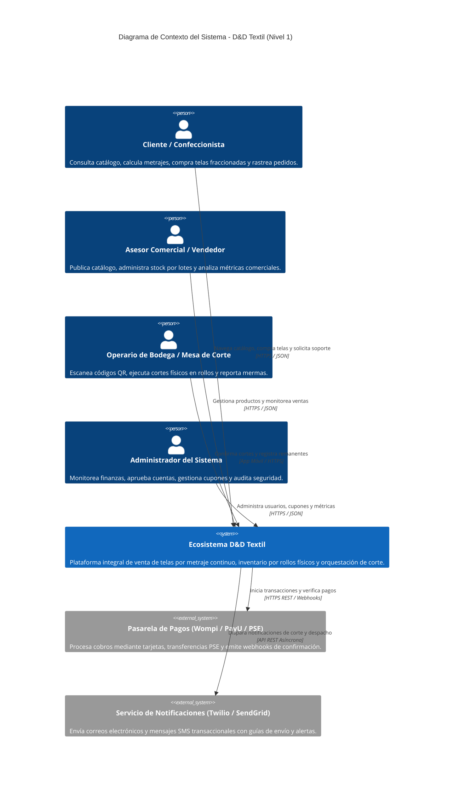
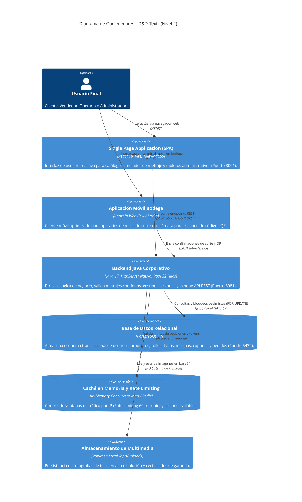
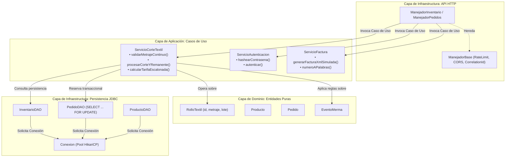
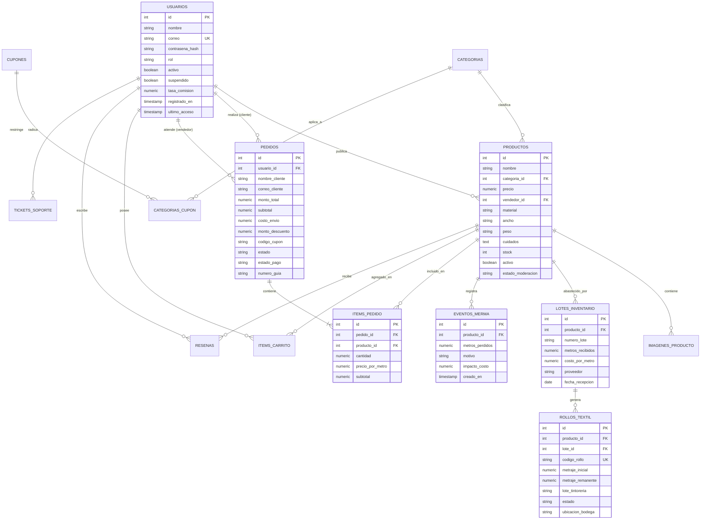
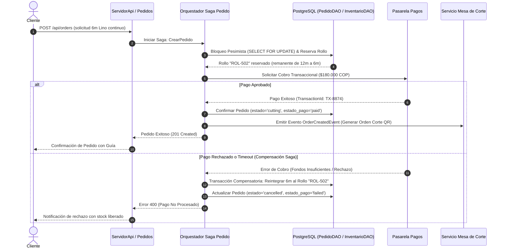

# 02. Arquitectura de Software, Modelo C4 y Contratos Técnicos
**Proyecto:** Plataforma Distribuida de Comercialización y Control Logístico Textil (**D&D Textil**)  
**Estándares:** Modelo C4 (Simon Brown), Domain-Driven Design (DDD), Event-Driven Architecture  
**Versión:** 2.0.0 — Sustentación Técnica SENA ADSO  
**Fecha:** Octubre 2026  

---

## 1. Modelo C4 — Vista Arquitectónica Multinivel

### 1.1. Nivel 1: Diagrama de Contexto del Sistema
El diagrama de contexto ilustra la interacción entre los distintos actores humanos, el ecosistema **D&D Textil** y los sistemas externos de soporte transaccional y de comunicación.



---

### 1.2. Nivel 2: Diagrama de Contenedores
Describe la topología de contenedores independientes, tecnologías de ejecución y protocolos de comunicación inter-servicio.



---

### 1.3. Nivel 3: Diagrama de Componentes (Módulo de Inventario y Corte Textil)
Detalla la estructura interna de clases, capas y flujo de ejecución bajo Clean Architecture:



---

## 2. Diseño de Datos y Diagrama Entidad-Relación (DER)

### 2.1. Diagrama Entidad-Relación (Mermaid)



---

## 3. Diccionario de Datos Exhaustivo

### 3.1. Tabla: `usuarios`
| Campo | Tipo | Longitud | Nulo | Clave | Descripción de Negocio |
| :--- | :--- | :---: | :---: | :---: | :--- |
| `id` | `SERIAL` | 4 B | NO | **PK** | Identificador único secuencial del usuario. |
| `nombre` | `VARCHAR` | 100 | NO | - | Nombre completo o razón social del usuario. |
| `correo` | `VARCHAR` | 150 | NO | **UK** | Correo electrónico corporativo o personal (login). |
| `contrasena_hash`| `VARCHAR` | 255 | NO | - | Hash criptográfico SHA-256 en UTF-8 con salt. |
| `rol` | `VARCHAR` | 50 | NO | - | Rol RBAC: `cliente`, `vendedor`, `operario_corte`, `administrador`. |
| `activo` | `BOOLEAN` | 1 B | NO | - | Estado de activación de la cuenta (por defecto `true`). |
| `suspendido` | `BOOLEAN` | 1 B | NO | - | Indicador de suspensión administrativa de la cuenta. |
| `motivo_suspension` | `TEXT` | Variable | SÍ | - | Razón justificada de la suspensión disciplinaria. |
| `tasa_comision` | `NUMERIC` | 5,2 | SÍ | - | Porcentaje de comisión pactado con el vendedor (ej. 5.50%). |
| `registrado_en` | `TIMESTAMP` | 8 B | NO | - | Fecha y hora exacta de registro en el sistema. |
| `ultimo_acceso` | `TIMESTAMP` | 8 B | SÍ | - | Fecha y hora de la última autenticación exitosa. |

### 3.2. Tabla: `productos`
| Campo | Tipo | Longitud | Nulo | Clave | Descripción de Negocio |
| :--- | :--- | :---: | :---: | :---: | :--- |
| `id` | `SERIAL` | 4 B | NO | **PK** | Identificador unívoco del producto textil. |
| `nombre` | `VARCHAR` | 200 | NO | - | Nombre comercial del tejido (ej. "Lino Italiano Puro"). |
| `categoria_id` | `INTEGER` | 4 B | SÍ | **FK** | Referencia a la tabla `categorias(id)`. |
| `precio` | `NUMERIC` | 12,2 | NO | - | Precio base de venta por metro lineal en COP. |
| `vendedor_id` | `INTEGER` | 4 B | SÍ | **FK** | Referencia a `usuarios(id)` propietario del artículo. |
| `descripcion` | `TEXT` | Variable | SÍ | - | Descripción comercial y cualidades estéticas del tejido. |
| `material` | `VARCHAR` | 100 | SÍ | - | Composición textil (ej. 100% Algodón Peinado). |
| `ancho` | `VARCHAR` | 50 | SÍ | - | Ancho útil del rollo (ej. "1.50 metros"). |
| `peso` | `VARCHAR` | 50 | SÍ | - | Gramaje del tejido (ej. "280 g/m²"). |
| `cuidados` | `TEXT` | Variable | SÍ | - | Instrucciones de lavado, planchado y secado. |
| `stock` | `INTEGER` | 4 B | NO | - | Existencia física total agregada en metros lineales. |
| `destacado` | `BOOLEAN` | 1 B | NO | - | Flag para exhibición en banner principal o destacados. |
| `activo` | `BOOLEAN` | 1 B | NO | - | Visibilidad en catálogo público para clientes. |
| `estado_moderacion` | `VARCHAR` | 50 | NO | - | Estado de aprobación: `pending`, `approved`, `rejected`. |

### 3.3. Tabla: `rollos_textil`
| Campo | Tipo | Longitud | Nulo | Clave | Descripción de Negocio |
| :--- | :--- | :---: | :---: | :---: | :--- |
| `id` | `SERIAL` | 4 B | NO | **PK** | Identificador primario del rollo físico. |
| `producto_id` | `INTEGER` | 4 B | NO | **FK** | Relación con el producto textil en `productos(id)`. |
| `lote_id` | `INTEGER` | 4 B | NO | **FK** | Relación con el lote de compra en `lotes_inventario(id)`. |
| `codigo_rollo` | `VARCHAR` | 50 | NO | **UK** | Código único de barras o QR físico (ej. "ROL-2026-0089"). |
| `metraje_inicial` | `NUMERIC` | 10,2 | NO | - | Longitud original con la que llegó el rollo de fábrica (m). |
| `metraje_remanente`| `NUMERIC`| 10,2 | NO | - | Metros exactos disponibles actualmente en el rollo. |
| `lote_tintoreria` | `VARCHAR` | 50 | NO | - | Partida o tintura química (ej. "TINT-AZUL-L44"). |
| `estado` | `VARCHAR` | 30 | NO | - | Estado: `disponible`, `reservado`, `retazo_liquidado`, `agotado`. |
| `ubicacion_bodega` | `VARCHAR` | 50 | SÍ | - | Coordenada en estantería (ej. "EST-04-NIVEL-2"). |

### 3.4. Tabla: `eventos_merma`
| Campo | Tipo | Longitud | Nulo | Clave | Descripción de Negocio |
| :--- | :--- | :---: | :---: | :---: | :--- |
| `id` | `SERIAL` | 4 B | NO | **PK** | Identificador del registro de merma. |
| `producto_id` | `INTEGER` | 4 B | NO | **FK** | Referencia a `productos(id)`. |
| `metros_perdidos` | `NUMERIC` | 10,2 | NO | - | Metros descontados del inventario por desperdicio o retazo. |
| `motivo` | `VARCHAR` | 100 | NO | - | Causa: `remanente_sub_metro`, `corte_defectuoso`, `mancha_fabrica`. |
| `impacto_costo` | `NUMERIC` | 10,2 | SÍ | - | Valorización monetaria de la pérdida según costo de compra. |
| `creado_en` | `TIMESTAMP` | 8 B | NO | - | Fecha y hora en la que se reportó la merma. |

### 3.5. Tabla: `pedidos`
| Campo | Tipo | Longitud | Nulo | Clave | Descripción de Negocio |
| :--- | :--- | :---: | :---: | :---: | :--- |
| `id` | `SERIAL` | 4 B | NO | **PK** | Identificador numérico del pedido comercial. |
| `usuario_id` | `INTEGER` | 4 B | SÍ | **FK** | Cuenta de cliente compradora en `usuarios(id)`. |
| `nombre_cliente` | `VARCHAR` | 150 | NO | - | Nombre de la persona que recibe el despacho. |
| `correo_cliente` | `VARCHAR` | 150 | NO | - | Correo para envío de factura y guía de rastreo. |
| `telefono_cliente` | `VARCHAR` | 50 | SÍ | - | Teléfono de contacto para la transportadora. |
| `direccion_envio` | `TEXT` | Variable | NO | - | Nomenclatura física completa de entrega. |
| `ciudad_envio` | `VARCHAR` | 100 | SÍ | - | Ciudad de destino (ej. Bogotá D.C., Medellín). |
| `departamento_envio`| `VARCHAR`| 100 | SÍ | - | Departamento colombiano (ej. Cundinamarca, Antioquia). |
| `monto_total` | `NUMERIC` | 12,2 | NO | - | Valor final total pagado por el cliente en COP. |
| `subtotal` | `NUMERIC` | 12,2 | SÍ | - | Sumatoria de precios de telas antes de impuestos y flete. |
| `costo_envio` | `NUMERIC` | 12,2 | SÍ | - | Flete liquidado según destino y volumen de tela. |
| `monto_descuento` | `NUMERIC` | 12,2 | SÍ | - | Descuento aplicado por cupón promocional o volumen. |
| `estado` | `VARCHAR` | 50 | NO | - | Estado: `pending`, `cutting`, `shipped`, `delivered`, `cancelled`. |
| `estado_pago` | `VARCHAR` | 50 | NO | - | Estado de cobro: `pending`, `paid`, `refunded`, `failed`. |
| `numero_guia` | `VARCHAR` | 100 | SÍ | - | Número de rastreo de transportadora o identificador QR de corte. |

---

## 4. Especificación de Eventos Asíncronos y Orquestación Saga

En un entorno desacoplado, la creación de un pedido coordina múltiples dominios mediante eventos de integración:



### 4.1. Payloads JSON de Eventos Canónicos

#### Evento: `OrderCreatedEvent`
```json
{
  "eventId": "evt_998471a2-c15e-42ab-89cd-48e02d0cfb88",
  "eventType": "ORDER_CREATED_FOR_CUTTING",
  "timestamp": "2026-10-14T15:30:00Z",
  "correlationId": "corr_c8a7b921-9310-4f81-a987-99b8214fa761",
  "payload": {
    "orderId": 1042,
    "customer": {
      "name": "María Confecciones SAS",
      "email": "produccion@mariaconfecciones.com",
      "city": "Medellín"
    },
    "items": [
      {
        "productId": 14,
        "productName": "Lino Crudo Puro",
        "requestedMeters": 6.0,
        "assignedRollId": "ROL-502",
        "dyeLot": "LOT-2026-A",
        "unitPrice": 30000.0,
        "subtotal": 180000.0
      }
    ],
    "cuttingStation": "MESA-02-NORTE",
    "qrCodePayload": "DND-ORDER-1042-ROL502-6M"
  }
}
```

#### Evento: `RollStockDepletedEvent` (Alerta de Merma o Retazo)
```json
{
  "eventId": "evt_31818bfa-5120-449e-b991-b1e840a1b802",
  "eventType": "ROLL_RECLASSIFIED_AS_REMNANT",
  "timestamp": "2026-10-14T15:35:10Z",
  "payload": {
    "rollId": "ROL-88",
    "productId": 7,
    "productName": "Seda Estampada Flora",
    "remainingMeters": 0.75,
    "thresholdLimit": 1.0,
    "actionTaken": "MOVED_TO_REMNANT_DISCOUNT",
    "discountApplied": 0.40,
    "remnantUnitPrice": 15000.0,
    "operatorId": 4
  }
}
```
