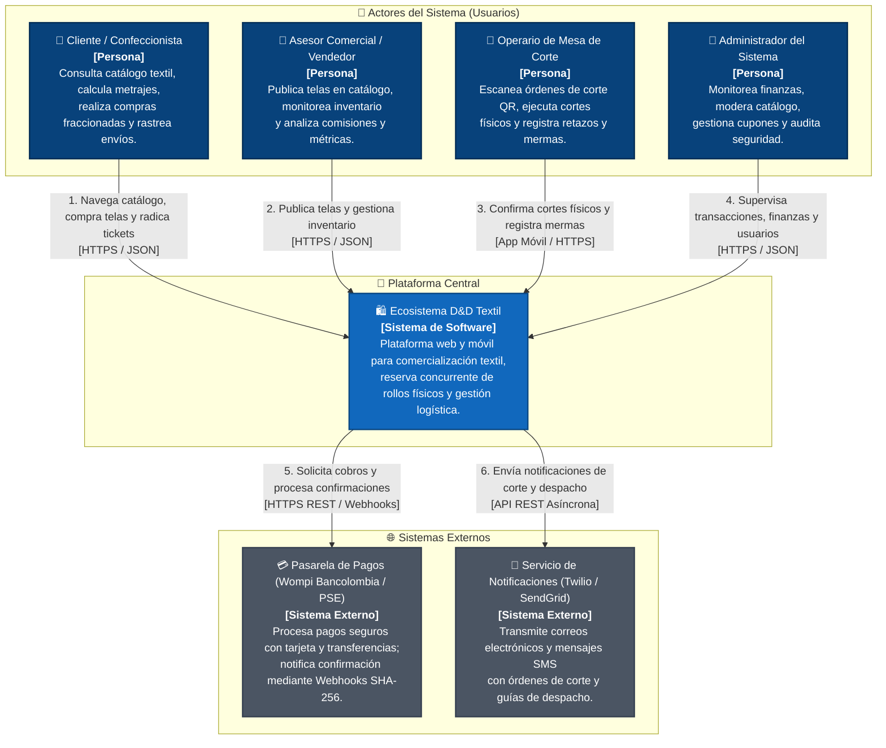
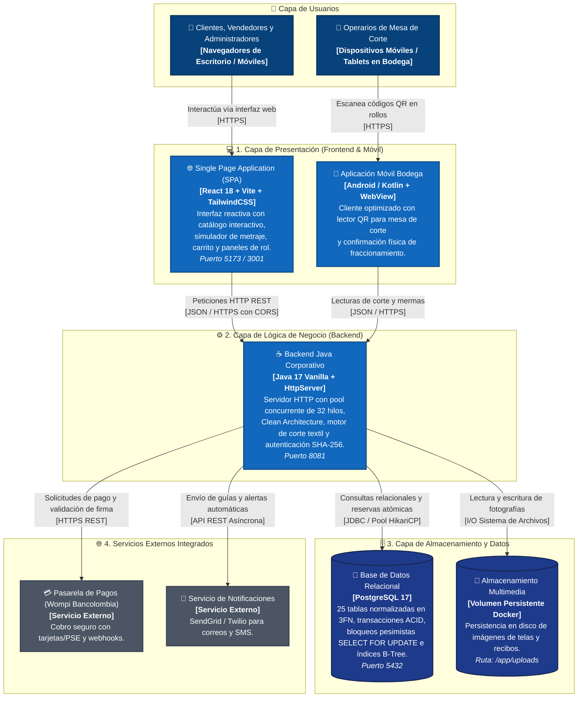
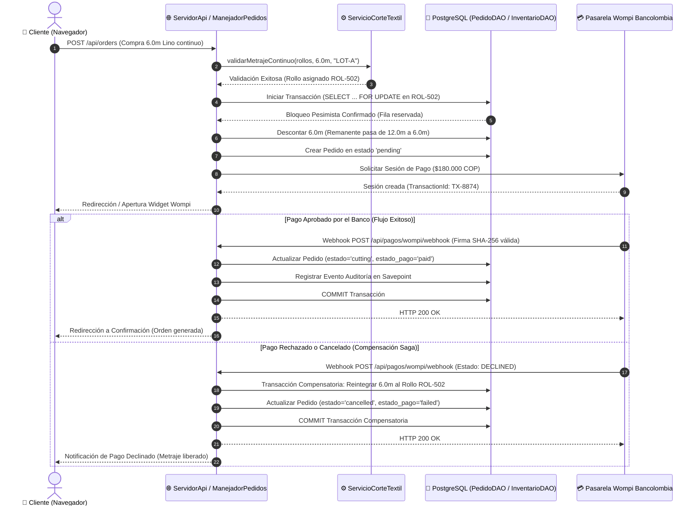

# Arquitectura de Software, Modelo C4 y Backend Java
**Proyecto:** Plataforma Distribuida de Comercializacion y Control Logistico Textil (D&D Textil)  
**Programa de Formacion:** Tecnologo en Analisis y Desarrollo de Software (ADSO) - SENA  
**Estandares:** Clean Architecture, Domain-Driven Design (DDD), Modelo C4 (Simon Brown), Principios SOLID  
**Version:** 2.0.0 - Documentacion Tecnica Oficial  

---

## 1. Vision General del Backend

El backend de **D&D Textil** es un servicio corporativo desarrollado en **Java 17 (Vanilla Java)** de alto rendimiento, disenado especificamente para eliminar la sobrecarga de memoria y dependencias de marcos de trabajo pesados como Spring Boot o Jakarta EE. 

### Caracteristicas Fundamentales del Diseno:
1. **Servidor HTTP Embebido de Alto Rendimiento:** Utiliza `com.sun.net.httpserver.HttpServer` configurado con un **Pool de Hilos Concurrente** (`Executors.newFixedThreadPool`) con un minimo de 32 hilos y escalable segun los nucleos de procesamiento (`Runtime.getRuntime().availableProcessors() * 8`). Esto garantiza la atencion simultanea de cientos de peticiones sin congelamiento de sockets.
2. **Pool de Conexiones JDBC con HikariCP:** Administra las conexiones fisicas hacia PostgreSQL mediante la libreria de alto rendimiento **HikariCP**, asegurando tiempos de obtencion de conexion inferiores a 5 milisegundos y liberacion automatica mediante bloques `try-with-resources`.
3. **Serializacion y Deserializacion JSON Segura:** Utiliza **Google Gson** para la transformacion bidireccional entre payloads JSON y modelos POJO del dominio, con anotaciones `@SerializedName` que garantizan compatibilidad bilingue y desacoplamiento de nombres de red.
4. **Arquitectura Limpia (Clean Architecture) Hibrida:** El codigo se organiza en tres capas independientes (**Dominio**, **Aplicacion** e **Infraestructura**), aplicando estrictamente el principio de inversion de dependencias para que las reglas de negocio no dependan de la base de datos ni del transporte HTTP.

---

## 2. Estructura Exhaustiva de Capas y Paquetes

La distribucion fisica del codigo fuente en `tienda digital de telas/backend-java/conexionPostgres/src/` se estructura de la siguiente manera:

```text
src/
 |
 +-- dominio/
 |    +-- modelos/                    # Entidades puras y objetos de valor
 |    |    +-- RolloTextil.java       # Entidad de trazabilidad por rollo fisico y tintoreria
 |    |    +-- Producto.java          # Ficha tecnica textil (precio, gramaje, ancho, stock)
 |    |    +-- Usuario.java           # Cuenta de usuario con rol RBAC, estado y comisiones
 |    |    +-- Pedido.java            # Encabezado de pedido comercial y estados de pago
 |    |    +-- LoteInventario.java    # Lote de compra a proveedores de tejeduria
 |    |    +-- EventoMerma.java       # Registro de retazos liquidados y mermas tecnicas
 |    |    +-- Cupon.java             # Reglas de cupones de descuento (porcentaje o fijo)
 |    |    +-- ItemCarrito.java       # Items temporales vinculados al carrito de compra
 |    |    +-- Resena.java            # Calificaciones y comentarios de clientes
 |    |    +-- TicketSoporte.java     # Reclamos de garantia y devoluciones
 |    |    +-- UmbralStock.java       # Alertas minimas de metros por categoria
 |    |    +-- ReporteError.java      # Reportes de incidencias tecnicas
 |    |    +-- DiapositivaCarrusel.java # Banners del carrusel dinamico de la tienda
 |    |    +-- SeccionInicio.java     # Secciones modulares de la pagina principal
 |    |    +-- BannerGlobal.java      # Barra de anuncios superior configurable
 |    |    +-- VentaDiaria.java       # Consolidado de ventas diarias para graficos
 |    |    +-- VentaRegion.java       # Distribucion porcentual de despachos por departamento
 |    |    +-- ActividadReciente.java # Pistas de auditoria administrativa
 |    +-- repositorios/               # Interfaces abstractas de persistencia
 |    |    +-- RepositorioUsuario.java # Contrato de persistencia de usuarios
 |    +-- excepciones/                # Excepciones de negocio
 |         +-- ExcepcionDominio.java  # Excepcion controlada para violacion de reglas
 |
 +-- aplicacion/
 |    +-- servicios/                  # Casos de uso y logica de negocio
 |         +-- ServicioCorteTextil.java  # Motor de validacion continua, mermas y tarifas
 |         +-- ServicioAutenticacion.java # Hasheo SHA-256 en UTF-8 y validacion de roles
 |         +-- ServicioFactura.java       # Generador de representacion XML simulada
 |
 +-- infraestructura/
 |    +-- configuracion/
 |    |    +-- Conexion.java          # Inicializacion del Pool HikariCP y driver PostgreSQL
 |    +-- persistencia/jdbc/          # Acceso a datos relacionales (DAOs)
 |    |    +-- JdbcRepositorioUsuarioImpl.java # Implementacion del contrato RepositorioUsuario
 |    |    +-- UsuarioDAO.java        # Consultas SQL para gestion de usuarios
 |    |    +-- ProductoDAO.java       # Consultas y persistencia de telas e imagenes
 |    |    +-- PedidoDAO.java         # Transacciones atomicas con SELECT FOR UPDATE
 |    |    +-- InventarioDAO.java     # Gestion de lotes, mermas y rollos fisicos
 |    |    +-- CarritoDAO.java        # Persistencia de items de carrito por usuario
 |    |    +-- CuponDAO.java          # Validacion de codigos promocionales
 |    |    +-- SoporteDAO.java        # Administracion de tickets de reclamos
 |    |    +-- ResenasDAO.java        # Persistencia de calificaciones
 |    |    +-- CarruselDAO.java       # Gestion de diapositivas
 |    |    +-- SeccionesInicioDAO.java # Configuracion de secciones dinamicas
 |    |    +-- ConfiguracionDAO.java  # Parametros globales del sistema
 |    +-- api/
 |         +-- ServidorApi.java       # Servidor HTTP central, enrutamiento y DI manual
 |         +-- manejadores/           # Controladores de endpoints REST
 |              +-- ManejadorBase.java              # Filtros comunes: RateLimit, CORS, CorrelationId
 |              +-- ManejadorAutenticacion.java     # POST /api/login, /api/register
 |              +-- ManejadorProductos.java         # GET/POST/PUT/DELETE /api/products
 |              +-- ManejadorPedidos.java           # GET/POST /api/orders, actualizacion de estados
 |              +-- ManejadorCarrito.java           # GET/POST/DELETE /api/cart
 |              +-- ManejadorCupones.java           # GET/POST /api/cupones, validacion
 |              +-- ManejadorInventario.java        # GET/POST /api/inventory, lotes, mermas
 |              +-- ManejadorUsuarios.java          # GET/PUT /api/users, suspension, activacion
 |              +-- ManejadorSoporte.java           # GET/POST /api/support, tickets y bugs
 |              +-- ManejadorResenas.java           # GET/POST /api/reviews
 |              +-- ManejadorCarrusel.java          # GET/POST/PUT/DELETE /api/carousel
 |              +-- ManejadorSeccionesInicio.java   # GET/POST/PUT /api/home-sections
 |              +-- ManejadorConfiguracion.java     # GET/POST /api/settings
 |              +-- ManejadorArchivosEstaticos.java # GET /uploads/* con prevencion path traversal
 |              +-- ManejadorSalud.java             # GET /health/live, /health/ready
 |
 +-- App.java                         # Punto de entrada de la aplicacion
 +-- PobladorDatosPrueba.java         # Sembrador automatico de datos y contrasenas SHA-256
 +-- PruebasReglasNegocioTextil.java  # Suite de pruebas unitarias (14 pruebas)
 +-- PruebasSeguridadYBugs.java       # Suite de pruebas de seguridad y concurrencia (12 pruebas)
```

---

## 3. Modelo C4 - Diagramas de Arquitectura

### 3.1. Nivel 1: Diagrama de Contexto del Sistema

A continuación se presenta el **Diagrama de Contexto (Nivel 1)** del Ecosistema D&D Textil, organizado formalmente con delimitación de límites, roles de usuario, plataforma central y servicios externos integrados:



---

### 3.2. Nivel 2: Diagrama de Contenedores

A continuación se ilustra la interacción entre los contenedores de software que conforman el ecosistema (SPA en React, App Móvil en Android/Kotlin, Backend en Java 17, Base de Datos PostgreSQL 17 y Almacenamiento Multimedia):



---

### 3.3. Nivel 3: Diagrama de Componentes (Modulo de Inventario y Corte Textil)

A continuación se detalla la arquitectura de componentes interna del Backend Java, reflejando estrictamente la separación de responsabilidades de **Clean Architecture** (Infraestructura HTTP, Casos de Uso, Entidades de Dominio, Persistencia JDBC y Base de Datos):

```mermaid
flowchart TD
    classDef httpStyle fill:#1e3a8a,stroke:#3b82f6,stroke-width:2px,color:#ffffff,font-family:sans-serif;
    classDef appStyle fill:#065f46,stroke:#10b981,stroke-width:2px,color:#ffffff,font-family:sans-serif;
    classDef domainStyle fill:#581c87,stroke:#a855f7,stroke-width:2px,color:#ffffff,font-family:sans-serif;
    classDef daoStyle fill:#7c2d12,stroke:#f97316,stroke-width:2px,color:#ffffff,font-family:sans-serif;
    classDef dbStyle fill:#0f172a,stroke:#64748b,stroke-width:2px,color:#ffffff,font-family:sans-serif;

    subgraph CapaHTTP ["1. Capa de Infraestructura HTTP (Controladores REST)"]
        direction TB
        ManejadorBase["ManejadorBase<br/>• RateLimiting (120 req/min)<br/>• Validación CORS y Encabezados<br/>• Filtro X-Correlation-ID"]:::httpStyle
        
        subgraph HandlersEspecializados ["Manejadores Especializados (Extienden ManejadorBase)"]
            direction LR
            ManejadorAuth["ManejadorAutenticacion<br/>(/api/login, /api/register)"]:::httpStyle
            ManejadorProd["ManejadorProductos<br/>(/api/products, filtros)"]:::httpStyle
            ManejadorPed["ManejadorPedidos<br/>(/api/orders, checkout)"]:::httpStyle
            ManejadorInv["ManejadorInventario<br/>(/api/inventory, rollos, mermas)"]:::httpStyle
        end
        HandlersEspecializados -.->|Heredan control| ManejadorBase
    end

    subgraph CapaAplicacion ["2. Capa de Aplicación (Servicios y Casos de Uso)"]
        direction LR
        ServicioAuth["ServicioAutenticacion<br/>• hashearContrasena()<br/>• validarCredenciales()"]:::appStyle
        ServicioCorte["ServicioCorteTextil<br/>• validarMetrajeContinuo()<br/>• procesarCorteYRemanente()<br/>• calcularTarifaEscalonada()"]:::appStyle
        ServicioWompi["ServicioCriptoWompi<br/>• generarFirmaIntegridad()<br/>• validarChecksumWebhook()"]:::appStyle
        ServicioFac["ServicioFactura<br/>• generarFacturaXmlSimulada()"]:::appStyle
    end

    subgraph CapaDominio ["3. Capa de Dominio (Entidades de Negocio Puras)"]
        direction LR
        Rollo["RolloTextil<br/>(codigo, metros, lote_tintoreria)"]:::domainStyle
        Producto["Producto<br/>(precio, ancho, peso, stock)"]:::domainStyle
        Pedido["Pedido<br/>(items, total, estado_pago)"]:::domainStyle
        Merma["EventoMerma<br/>(metros_perdidos, motivo, costo)"]:::domainStyle
    end

    subgraph CapaPersistencia ["4. Capa de Persistencia (DAOs y Pool HikariCP)"]
        direction LR
        UsuarioDAO["UsuarioDAO<br/>(Cuentas RBAC)"]:::daoStyle
        ProductoDAO["ProductoDAO<br/>(Fichas Textiles)"]:::daoStyle
        PedidoDAO["PedidoDAO<br/>(Transacciones Atómicas)"]:::daoStyle
        InventarioDAO["InventarioDAO<br/>(Rollos y Lotes)"]:::daoStyle
        PagoWompiDAO["PagoWompiDAO<br/>(Auditoría Webhooks)"]:::daoStyle
        ConexionPool[("Conexion (HikariCP)<br/>Pool de 20 conexiones")]:::daoStyle
    end

    subgraph MotorPostgres ["5. Base de Datos"]
        PostgresDB[("🐘 PostgreSQL 17<br/>Bloqueo SELECT FOR UPDATE")]:::dbStyle
    end

    %% Invocaciones entre capas
    ManejadorAuth -->|Invoca| ServicioAuth
    ManejadorProd -->|Consulta catálogo| ProductoDAO
    ManejadorPed -->|Ejecuta validación y corte| ServicioCorte
    ManejadorPed -->|Calcula firma y valida pago| ServicioWompi
    ManejadorPed -->|Genera XML| ServicioFac
    ManejadorInv -->|Aplica reglas de fraccionamiento| ServicioCorte

    ServicioCorte -->|Manipula ciclo de vida| Rollo
    ServicioCorte -->|Genera registro| Merma
    ServicioCorte -->|Actualiza metros| InventarioDAO
    ServicioAuth -->|Consulta usuarios| UsuarioDAO
    ServicioWompi -->|Registra evento con Savepoint| PagoWompiDAO

    ManejadorPed -->|Persiste orden y detalle| PedidoDAO

    UsuarioDAO --> ConexionPool
    ProductoDAO --> ConexionPool
    PedidoDAO --> ConexionPool
    InventarioDAO --> ConexionPool
    PagoWompiDAO --> ConexionPool

    ConexionPool -->|Sentencias SQL Preparadas| PostgresDB
```



---

## 4. Implementacion de los Principios SOLID en el Backend

El backend implementa los cinco principios de diseno de Robert C. Martin:

### 4.1. S - Single Responsibility Principle (Principio de Responsabilidad Unica)
Cada componente posee una sola razon para cambiar:
- `ManejadorAutenticacion`: Se limita a capturar la peticion HTTP, verificar cabeceras CORS, deserializar el cuerpo JSON y enviar la respuesta HTTP correspondiente. No ejecuta hashes ni consultas SQL.
- `ServicioAutenticacion`: Contiene exclusivamente la logica de negocio (generacion de hash SHA-256 en UTF-8, verificacion de suspension de cuenta y evaluacion de roles).
- `UsuarioDAO` / `JdbcRepositorioUsuarioImpl`: Maneja de forma estricta las sentencias SQL preparadas (`SELECT`, `INSERT`, `UPDATE`), mapeando los conjuntos de resultados (`ResultSet`) a instancias de `Usuario`.

### 4.2. O - Open/Closed Principle (Principio de Abierto/Cerrado)
El despachador central `ServidorApi.java` esta estructurado para incorporar nuevas rutas de la API sin requerir la modificacion de los manejadores existentes. Nuevos metodos de calculo textil o pasarelas de pago extienden las interfaces de dominio sin alterar los flujos ya probados.

### 4.3. L - Liskov Substitution Principle (Principio de Sustitucion de Liskov)
Todos los controladores del sistema extienden de `ManejadorBase`, el cual implementa el contrato estandar `HttpHandler` de Java. Cualquier manejador concreto (`ManejadorProductos`, `ManejadorPedidos`, `ManejadorInventario`) puede ser sustituido por una version mock de pruebas sin alterar el funcionamiento del servidor.

### 4.4. I - Interface Segregation Principle (Principio de Segregacion de Interfaces)
Las interfaces del dominio (`dominio/repositorios/`) definen metodos estrictamente acotados a su entidad. `RepositorioUsuario` define unicamente operaciones sobre usuarios (`buscarPorCorreo`, `guardar`), evitando que los consumidores queden acoplados a metodos de inventario o facturacion.

### 4.5. D - Dependency Inversion Principle (Principio de Inversion de Dependencia)
Los modulos de alto nivel (casos de uso) no dependen de las clases de acceso a datos de bajo nivel; ambos dependen de abstracciones. En `ServidorApi.java` se realiza la inyeccion de dependencias desacoplando la persistencia de las reglas de negocio:

```java
// 1. Instanciacion de persistencia de bajo nivel (Detalle Tecnico)
RepositorioUsuario repositorioUsuario = new JdbcRepositorioUsuarioImpl();

// 2. Inyeccion de la abstraccion al servicio de alto nivel
ServicioAutenticacion servicioAutenticacion = new ServicioAutenticacion(repositorioUsuario);

// 3. Inyeccion del servicio al controlador HTTP final
ManejadorAutenticacion manejadorAutenticacion = new ManejadorAutenticacion(servicioAutenticacion);
```

---

## 5. Orquestacion Transaccional Saga y Eventos Asincronos

Para gestionar la consistencia en el proceso de compra de tela continua y fraccionada, el sistema implementa una máquina de estados tipo **Saga Coreografiada** con transacciones compensatorias automáticas ante fallos de pago o cancelación:



---

## 6. Catalogo General de Endpoints de la API REST

El servidor escucha por defecto en el puerto **`8081`** y expone cabeceras CORS para integracion con el cliente web y movil:

| Metodo | Ruta | Descripcion | Payload Entrada | Codigos de Respuesta |
| :---: | :--- | :--- | :--- | :---: |
| `POST` | `/api/login` | Autenticacion con hash SHA-256 en UTF-8 | `{"email":"...", "password":"..."}` | 200, 400, 403 |
| `POST` | `/api/register` | Registro de nuevos clientes | `{"name":"...", "email":"...", "password":"..."}` | 201, 400 |
| `GET` | `/api/users` | Listado administrativo de usuarios | N/A | 200, 403 |
| `PUT` | `/api/users/{id}/suspend` | Suspension disciplinaria de cuenta | `{"reason":"..."}` | 200, 400, 403 |
| `PUT` | `/api/users/{id}/activate` | Reactivacion de cuenta suspendida | N/A | 200, 400, 403 |
| `GET` | `/api/products` | Catalogo con filtros de categoria y busqueda | Query Params: `category`, `q` | 200 |
| `POST` | `/api/products` | Publicacion de nueva tela en catalogo | JSON con ficha tecnica textil | 201, 400 |
| `GET` | `/api/products/{id}` | Detalle completo de una tela | N/A | 200, 404 |
| `PUT` | `/api/products/{id}/image` | Subida de fotografia en Base64 | `{"image":"data:image/jpeg;base64,..."}` | 200, 400 |
| `GET` | `/api/orders` | Consulta de pedidos segun rol | N/A | 200 |
| `POST` | `/api/orders` | Creacion de pedido con reserva continua | JSON con datos de envio e items | 201, 400 |
| `PUT` | `/api/orders/{id}/status` | Cambio de estado (`cutting`, `shipped`) | `{"status":"cutting"}` | 200, 400 |
| `GET` | `/api/orders/{id}/invoice` | Emision de representacion XML simulada | N/A | 200, 404 |
| `GET` | `/api/cart` | Obtener items de carrito del usuario | N/A | 200 |
| `POST` | `/api/cart` | Agregar tela al carrito de compras | `{"productId":14, "quantity":6}` | 200, 400 |
| `DELETE` | `/api/cart` | Vaciar carrito o eliminar item especifico | Query Param: `productId` (opcional) | 200 |
| `POST` | `/api/cupones/validar` | Validacion de cupon con reglas de categoria | `{"codigo":"DESCUENTO20"}` | 200, 400 |
| `GET` | `/api/inventory/batches` | Consulta de lotes de recepcion de telas | N/A | 200 |
| `POST` | `/api/inventory/batches` | Registro de nuevo lote de compra | JSON con lote, metros y proveedor | 201, 400 |
| `GET` | `/api/inventory/waste` | Historial de mermas y retazos liquidados | N/A | 200 |
| `POST` | `/api/inventory/waste` | Registro manual de merma en corte | JSON con metros perdidos y motivo | 201, 400 |
| `GET` | `/health/live` | Probe de liveness (servidor vivo) | N/A | 200 |
| `GET` | `/health/ready` | Probe de readiness (conexion PostgreSQL activa) | N/A | 200, 503 |
