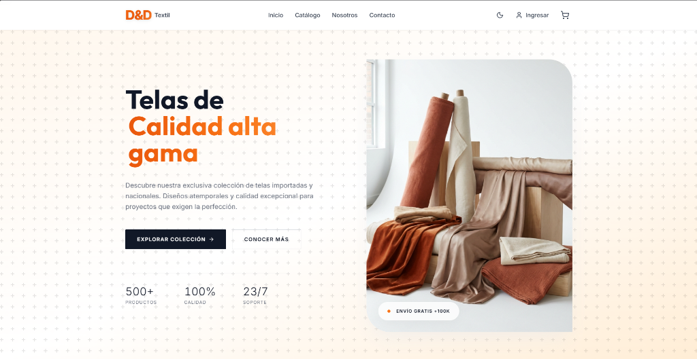
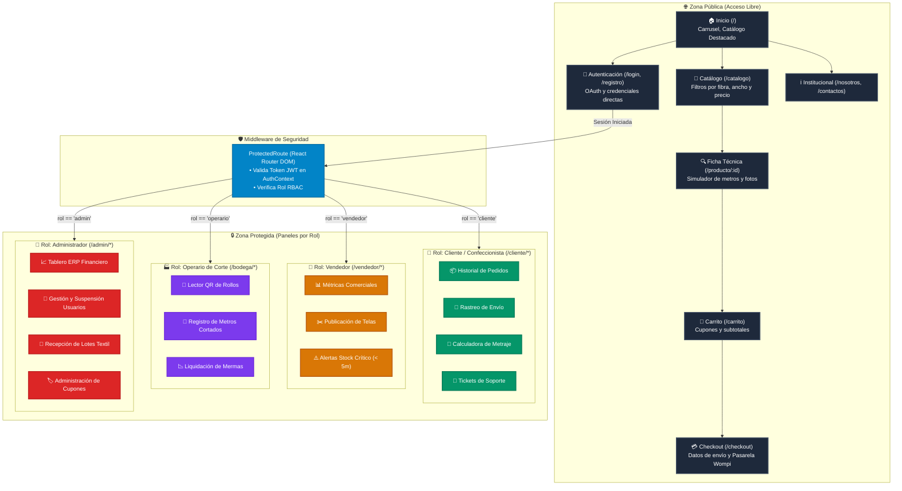

# Arquitectura del Frontend y Gestion de Roles de Usuario
**Proyecto:** Plataforma Distribuida de Comercializacion y Control Logistico Textil (D&D Textil)  
**Programa de Formacion:** Tecnologo en Analisis y Desarrollo de Software (ADSO) - SENA  
**Tecnologias:** React 18, Vite 5, TailwindCSS 3, Context API, React Router DOM v6  
**Version:** 2.0.0 - Documentacion Tecnica Oficial  

---

## 1. Arquitectura de la Interfaz de Usuario (Frontend)

El frontend de **D&D Textil** esta estructurado como una aplicacion de pagina unica (**Single Page Application - SPA**) utilizando **React 18** y el empaquetador de alto desempeno **Vite 5**. La arquitectura delega el renderizado al navegador del cliente mediante el DOM virtual, eliminando las recargas de pagina tradicionales y proporcionando transiciones fluidas de 60 cuadros por segundo.

### 1.1. Stack Tecnologico Principal
- **React 18.3.1:** Biblioteca base que implementa el paradigma funcional y de componentes declarativos. Aprovecha tecnicas de actualizacion granular del arbol de componentes (*reconciliation*) para actualizar unicamente los nodos que sufren cambios de estado.
- **Vite 5.4.11:** Empaquetador modular que utiliza modulos ECMAScript nativos (ESM) en desarrollo, acelerando el arranque en caliente (*Hot Module Replacement - HMR*) en menos de 100 milisegundos.
- **TailwindCSS 3.4.1:** Motor de estilos atomicos basado en utilidades de generacion Just-In-Time (JIT). Facilita el diseno consistente de interfaces bajo la estetica *Glassmorphism* (fondos translucidos, bordes tenues y desenfoques `backdrop-blur`).
- **Context API de React:** Sistema nativo de propagacion de estado global para sesiones de usuario (`AuthContext`) y persistencia de articulos de compra (`CartContext`).
- **React Router DOM 6.22.0:** Sistema de enrutamiento del lado del cliente con proteccion condicional de rutas segun el rol del usuario autenticado.

### 1.2. Vista Previa de la Interfaz Principal (Landing Page)



---

## 2. Estructura de Directorios del Frontend (`tienda digital de telas/src/`)

El codigo fuente del frontend se organiza de forma modular para garantizar alta cohesión y bajo acoplamiento:

```text
tienda digital de telas/src/
 |
 +-- assets/                  # Iconos SVG, logotipos e imagenes estaticas
 +-- components/              # Componentes visuales reutilizables
 |    +-- Navbar.jsx          # Barra de navegacion principal con detector de sesion
 |    +-- Footer.jsx          # Pie de pagina institucional y enlaces legales
 |    +-- GlobalBanner.jsx    # Cintillo de anuncios promocionales configurables
 |    +-- ProductCard.jsx     # Tarjeta de tela con precio por metro y vista rapida
 |    +-- ProtectedRoute.jsx  # Componente de orden superior para restriccion RBAC
 |    +-- Toast.jsx           # Notificaciones flotantes de exito y error
 |
 +-- context/                 # Proveedores de estado global
 |    +-- AuthContext.jsx     # Gestion de token, perfil de usuario, login y logout
 |    +-- CartContext.jsx     # Sincronizacion de metros, subtotales y cupones
 |
 +-- pages/                   # Vistas principales de la aplicacion
 |    +-- Home.jsx            # Pantalla de inicio con carrusel y secciones destacadas
 |    +-- Catalog.jsx         # Catalogo completo con filtros por categoria y precio
 |    +-- ProductDetail.jsx   # Ficha tecnica, selector de metraje y galeria Base64
 |    +-- Cart.jsx            # Carrito de compra y aplicacion de cupones
 |    +-- Checkout.jsx        # Captura de datos de envio y liquidacion de flete
 |    +-- CheckoutSuccess.jsx # Confirmacion de pedido con numero de guia y QR
 |    +-- About.jsx           # Informacion corporativa de D&D Textil
 |    +-- Contact.jsx         # Formulario de contacto y ubicacion
 |    +-- Login.jsx           # Formulario reactivo de autenticacion
 |    +-- Register.jsx        # Formulario reactivo de registro de clientes
 |
 +-- panels/                  # Tableros de control segun rol
 |    +-- customer/           # Panel del Cliente
 |    |    +-- CustomerDashboard.jsx  # Resumen de pedidos recientes y estado
 |    |    +-- CustomerOrders.jsx     # Historial de compras y factura simulada
 |    |    +-- OrderTracking.jsx      # Linea de tiempo de corte y despacho
 |    |    +-- MeterCalculator.jsx    # Calculadora inteligente de metrajes
 |    |    +-- SupportTickets.jsx     # Radicacion de reclamos de garantia
 |    |    +-- Wishlist.jsx           # Telas guardadas como favoritas
 |    |
 |    +-- seller/             # Panel del Vendedor
 |    |    +-- SellerDashboard.jsx    # Analitica comercial e ingresos
 |    |    +-- ProductManagement.jsx  # Publicacion y edicion de stock textil
 |    |    +-- LowStockAlerts.jsx     # Notificaciones de telas por agotarse (< 5m)
 |    |
 |    +-- admin/              # Panel del Administrador
 |         +-- AdminDashboard.jsx     # Metricas financieras globales
 |         +-- UserManagement.jsx     # Suspension y activacion de cuentas
 |         +-- InventoryBatches.jsx   # Entrada de lotes de tejeduria
 |         +-- WasteManagement.jsx    # Registro de mermas y retazos liquidados
 |         +-- CouponManagement.jsx   # Creacion de reglas de cupones
 |
 +-- utils/                   # Funciones auxiliares y formateadores
      +-- api.js              # Cliente HTTP centralizado con manejo de cabeceras
      +-- formatters.js       # Formateador de moneda colombiana (COP) y metros
```

---

## 3. Matriz de Roles y Permisos de Navegacion (RBAC)

La plataforma cuenta con cuatro roles de usuario claramente diferenciados, con permisos explicitos sobre las rutas y vistas del sistema:

| Rol de Usuario | Prefijo de Ruta | Vistas y Capacidades Autorizadas | Restricciones de Seguridad |
| :--- | :--- | :--- | :--- |
| **Cliente** | `/cliente/*` | Consulta de pedidos propios, seguimiento de envio (`/cliente/rastreo`), uso de la calculadora de metraje, lista de deseos y radicacion de tickets de garantia. | Bloqueado para ver pedidos ajenos, catalogar productos o acceder a paneles de gestion. |
| **Vendedor** | `/vendedor/*` | Publicacion de telas, actualizacion de stock, visualizacion de sus propias ventas y recepcion de alertas de stock critico (< 5 metros). | Solo puede editar productos vinculados a su identificador de usuario (`vendedor_id`). |
| **Operario de Corte** | `/bodega/*` | Escaneo de ordenes de corte con codigo QR, validacion de rollos fisicos y registro de metros cortados y mermas. | No tiene acceso a informacion de precios de venta, utilidades ni facturacion. |
| **Administrador** | `/admin/*` | Moderacion de productos, suspension o reactivacion de usuarios, configuracion de umbrales criticos, creacion de cupones y metricas globales. | Acceso total con registro de auditoria inmutable en cada accion. |

---

## 4. Mapa de Navegacion del Ecosistema

A continuación se presenta el **Diagrama del Mapa de Navegación del Frontend**, ilustrando la segmentación entre las rutas públicas de libre acceso, el filtro de protección RBAC (`ProtectedRoute`) y los tableros de control especializados para cada rol:



---

### 4.1. Vistas Publicas (Sin Autenticacion Requerida)
- **Inicio (`/`):** Exposicion del catalogo destacado, colecciones de temporada y banner de anuncios superior.
- **Catalogo de Telas (`/catalogo`):** Tarjetas interactivas con busqueda en tiempo real por texto y filtrado por categorias (Algodon, Seda, Lino, Dril, Terciopelo, etc.).
- **Detalle de Producto (`/producto/:id`):** Visualizacion de fotografia en alta resolucion, ancho util, peso, cuidados textiles y selector dinamico de metros con validacion de disponibilidad.
- **Carrito de Compras (`/carrito`):** Administracion de items seleccionados, calculo de subtotales y aplicacion de cupones de descuento.
- **Proceso de Pago (`/checkout` y `/checkout/success`):** Formulario de datos de despacho, confirmacion de pasarela de pago y generacion del comprobante con numero de orden.
- **Sobre Nosotros (`/nosotros`) y Contacto (`/contactos`):** Paginas institucionales y formulario de contacto interactivo con mapa de ubicación.
- **Acceso (`/login` y `/registro`):** Formularios con validacion de campos y soporte OAuth con Google/Microsoft.

### 4.2. Vistas Protegidas por Rol (Requieren Sesión Activa)
- **Cliente (`/cliente/*`):** Panel de gestión de compras, descarga de facturas simuladas, seguimiento en tiempo real y calculadora textil.
- **Vendedor (`/vendedor/*`):** Publicación de telas, catálogo personal, liquidación de comisiones y control de inventario local.
- **Operario de Corte (`/bodega/*`):** Estación de corte móvil con lector de códigos QR para rollos físicos y registro de mermas.
- **Administrador (`/admin/*`):** Panel integral de supervisión, auditoría de usuarios, aprobación de lotes textiles y configuración global.

---

## 5. Motor y Formulas de la Calculadora de Metraje Inteligente

Ubicada en `/cliente/calculadora`, la **Calculadora de Metraje** asiste al confeccionista calculando la cantidad exacta de tela necesaria para un proyecto, incorporando un **margen de seguridad tecnico del diez por ciento (+10%)** para compensar encogimientos por lavado y desperdicios de corte de patron:

### Formulas Matematicas Implementadas:

1. **Cortinas Tradicionales:**
   $$\text{Metros} = \left( \text{Alto de Ventana} + 0.30\text{ m (dobladillo)} \right) \times \left( \frac{\text{Ancho} \times 2.0\text{ (pliegues)}}{\text{Ancho Util de Tela}} \right) \times 1.10$$

2. **Vestido Largo / Enterizo:**
   $$\text{Metros} = \left( \text{Largo de Prenda} + \text{Largo de Manga} + 0.25\text{ m} \right) \times 1.10$$

3. **Falda Circular o Plisada:**
   $$\text{Metros} = \left( 2 \times \text{Largo de Falda} + 0.40\text{ m} \right) \times 1.10$$

4. **Manteles de Mesa:**
   $$\text{Metros} = \left( \text{Largo de Mesa} + 2 \times \text{Caida Deseada (0.25 m a 0.35 m)} \right) \times 1.10$$

5. **Cojines y Tapiceria:**
   $$\text{Metros} = \left( \text{Cantidad de Cojines} \times 0.55\text{ m} \right) \times 1.10$$

---

## 6. Arquitectura del Cliente Movil (Android Wrapper)

Ubicada en el modulo `TiendaTextilApp/`, la aplicacion movil ofrece una experiencia optimizada para dispositivos Android (telefonos y tabletas de operarios de corte y clientes):

### 6.1. Componentes del Contenedor Nativo
- **Lenguaje:** Kotlin 1.9+ sobre Android SDK 34 (Android 14) con compatibilidad hacia atras hasta Android 7.0 (API 24).
- **Contenedor WebView Optimizado:** Emplea `androidx.webkit.WebViewAssetLoader` para servir el paquete estatico compilado de la SPA de React desde el almacenamiento interno del dispositivo (`assets/`), eliminando la latencia de descarga por red celular en la carga inicial de vistas.
- **Configuracion de Red Segura:** Define un archivo de configuracion de seguridad de red (`network_security_config.xml`) que habilita el trafico HTTP en entornos de desarrollo local hacia la direccion IP del emulador Android (`10.0.2.2:8081`) o la IP de red local corporativa en dispositivos fisicos.
- **Manejo del Ciclo de Vida y Navegacion:** Integra el evento de retroceso de hardware (`OnBackPressedDispatcher`) para permitir navegacion por historial en la aplicacion web antes de finalizar la actividad principal.

