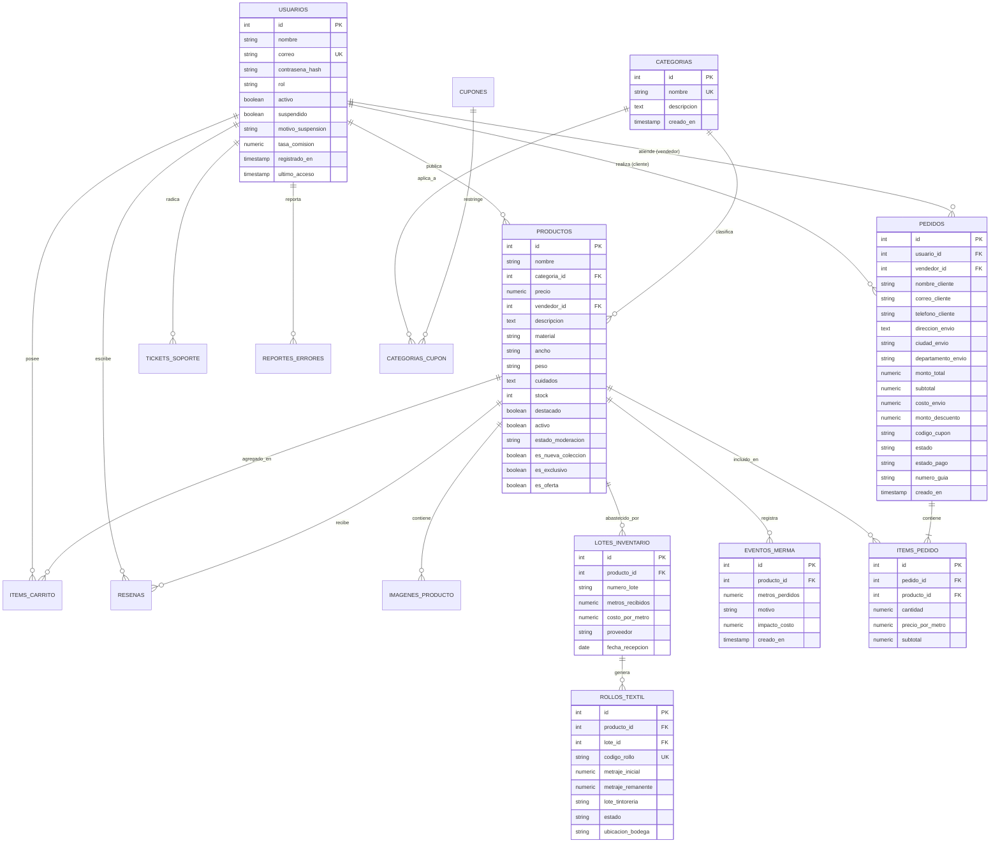

# Diseno, Estructura y Esquema de Base de Datos Relacional
**Proyecto:** Plataforma Distribuida de Comercializacion y Control Logistico Textil (D&D Textil)  
**Programa de Formacion:** Tecnologo en Analisis y Desarrollo de Software (ADSO) - SENA  
**Motor de Base de Datos:** PostgreSQL 17 (Codificacion UTF-8)  
**Version:** 2.0.0 - Documentacion Tecnica Oficial  

---

## 1. Diseno Arquitectonico de la Base de Datos

El modelo de datos de **D&D Textil** esta implementado sobre el motor relacional **PostgreSQL 17**, optimizado para garantizar la integridad transaccional (ACID), alta concurrencia mediante bloqueos a nivel de fila y consistencia estricta en el inventario fisico de telas.

### Principios de Diseno Aplicados:
1. **Normalizacion hasta Tercera Forma Normal (3FN):** Se eliminaron redundancias en catalogos, cupones y transacciones, manteniendo claves foraneas con restricciones de integridad referencial (`ON DELETE CASCADE` o `ON DELETE SET NULL` segun corresponda).
2. **Precision Decimal en Metrajes y Moneda:** Los precios y valores monetarios se modelan con el tipo `NUMERIC(12,2)` para prevenir errores de coma flotante en pesos colombianos (COP). Las longitudes de metraje de telas se modelan con `NUMERIC(10,2)` permitiendo fraccionamientos exactos de dos decimales (centimetros).
3. **Manejo Seguro de Identificadores y Seguridad:** Las contrasenas se almacenan en campos `VARCHAR(255)` que albergan el hash SHA-256 generado en UTF-8. No se almacena ninguna informacion referente a tarjetas de credito o claves bancarias (cumplimiento PCI-DSS).

---

## 2. Diagrama Entidad-Relacion (DER)



---

## 3. Diccionario de Datos Exhaustivo

### 3.1. Tabla: `usuarios`
Gestiona las credenciales y perfiles de acceso bajo el modelo RBAC.
| Nombre de Columna | Tipo de Dato | Tamano | Nulo | Restriccion | Descripcion Tecnica y de Negocio |
| :--- | :--- | :---: | :---: | :---: | :--- |
| `id` | `SERIAL` | 4 B | NO | **PK** | Identificador secuencial primario de usuario. |
| `nombre` | `VARCHAR` | 100 | NO | - | Nombre y apellido o razon social de la empresa. |
| `correo` | `VARCHAR` | 150 | NO | **UK** | Direccion de correo electronico corporativo o personal. |
| `contrasena_hash` | `VARCHAR` | 255 | NO | - | Hash criptografico SHA-256 generado en codificacion UTF-8. |
| `rol` | `VARCHAR` | 50 | NO | - | Rol de autorizacion: `cliente`, `vendedor`, `operario_corte`, `administrador`. |
| `activo` | `BOOLEAN` | 1 B | NO | - | Estado de habilitacion de la cuenta en el sistema. |
| `suspendido` | `BOOLEAN` | 1 B | NO | - | Indicador de bloqueo disciplinario de la cuenta. |
| `motivo_suspension` | `TEXT` | Variable | SI | - | Justificacion de la suspension emitida por el administrador. |
| `tasa_comision` | `NUMERIC` | 5,2 | SI | - | Porcentaje de comision pactada con el vendedor (ej. 5.50%). |
| `registrado_en` | `TIMESTAMP` | 8 B | NO | - | Marca temporal exacta de creacion de la cuenta. |
| `ultimo_acceso` | `TIMESTAMP` | 8 B | SI | - | Fecha y hora del inicio de sesion exitoso mas reciente. |

### 3.2. Tabla: `categorias`
Clasificacion de tejidos segun su origen y caracteristicas tecnicas.
| Nombre de Columna | Tipo de Dato | Tamano | Nulo | Restriccion | Descripcion Tecnica y de Negocio |
| :--- | :--- | :---: | :---: | :---: | :--- |
| `id` | `SERIAL` | 4 B | NO | **PK** | Identificador primario de la categoria. |
| `nombre` | `VARCHAR` | 100 | NO | **UK** | Nombre unico de la categoria (Algodon, Seda, Lino, etc.). |
| `descripcion` | `TEXT` | Variable | SI | - | Descripcion general de las aplicaciones del tejido. |
| `creado_en` | `TIMESTAMP` | 8 B | NO | - | Fecha de registro de la categoria. |

### 3.3. Tabla: `productos`
Catalogo maestro de telas disponibles para la venta.
| Nombre de Columna | Tipo de Dato | Tamano | Nulo | Restriccion | Descripcion Tecnica y de Negocio |
| :--- | :--- | :---: | :---: | :---: | :--- |
| `id` | `SERIAL` | 4 B | NO | **PK** | Identificador primario de la tela. |
| `nombre` | `VARCHAR` | 200 | NO | - | Nombre comercial del tejido (ej. "Lino Italiano Puro"). |
| `categoria_id` | `INTEGER` | 4 B | SI | **FK** | Referencia a `categorias(id)`. |
| `precio` | `NUMERIC` | 12,2 | NO | - | Precio base de venta por metro lineal en pesos colombianos (COP). |
| `vendedor_id` | `INTEGER` | 4 B | SI | **FK** | Referencia a `usuarios(id)` propietario de la tela. |
| `descripcion` | `TEXT` | Variable | SI | - | Descripcion comercial y tactil del tejido. |
| `material` | `VARCHAR` | 100 | SI | - | Composicion porcentual de fibras (ej. 100% Algodon Peinado). |
| `ancho` | `VARCHAR` | 50 | SI | - | Ancho util del rollo expresado en metros (ej. "1.50 metros"). |
| `peso` | `VARCHAR` | 50 | SI | - | Gramaje del tejido expresado en gramos por metro cuadrado (ej. "240 g/m2"). |
| `cuidados` | `TEXT` | Variable | SI | - | Recomendaciones de lavado, planchado y secado. |
| `stock` | `INTEGER` | 4 B | NO | - | Existencia fisica agregada en metros lineales. |
| `destacado` | `BOOLEAN` | 1 B | NO | - | Indicador para exhibicion en pagina principal. |
| `activo` | `BOOLEAN` | 1 B | NO | - | Visibilidad en catalogo publico. |
| `estado_moderacion` | `VARCHAR` | 50 | NO | - | Estado de aprobacion: `pending`, `approved`, `rejected`. |
| `motivo_rechazo` | `TEXT` | Variable | SI | - | Justificacion en caso de rechazo de publicacion. |
| `es_nueva_coleccion` | `BOOLEAN` | 1 B | NO | - | Marcador para colecciones de temporada. |
| `es_exclusivo` | `BOOLEAN` | 1 B | NO | - | Marcador para telas importadas o de edicion limitada. |
| `es_oferta` | `BOOLEAN` | 1 B | NO | - | Marcador de precios promocionales de descuento. |

### 3.4. Tabla: `rollos_textil`
Registro de unidades fisicas individuales para trazabilidad de corte y tintoreria.
| Nombre de Columna | Tipo de Dato | Tamano | Nulo | Restriccion | Descripcion Tecnica y de Negocio |
| :--- | :--- | :---: | :---: | :---: | :--- |
| `id` | `SERIAL` | 4 B | NO | **PK** | Identificador primario del rollo fisico. |
| `producto_id` | `INTEGER` | 4 B | NO | **FK** | Referencia a `productos(id)`. |
| `lote_id` | `INTEGER` | 4 B | NO | **FK** | Referencia a `lotes_inventario(id)`. |
| `codigo_rollo` | `VARCHAR` | 50 | NO | **UK** | Codigo escaneable de barras o QR (ej. "ROL-2026-0089"). |
| `metraje_inicial` | `NUMERIC` | 10,2 | NO | - | Metros lineales de fabricacion al ingresar a bodega. |
| `metraje_remanente` | `NUMERIC` | 10,2 | NO | - | Metros lineales disponibles actualmente para corte. |
| `lote_tintoreria` | `VARCHAR` | 50 | NO | - | Partida quimica de tintura (ej. "TINT-AZUL-L44"). |
| `estado` | `VARCHAR` | 30 | NO | - | Estado: `disponible`, `reservado`, `retazo_liquidado`, `agotado`. |
| `ubicacion_bodega` | `VARCHAR` | 50 | SI | - | Posicion en estanteria (ej. "EST-04-NIVEL-2"). |

### 3.5. Tabla: `lotes_inventario`
Control de entradas masivas de tejidos provistos por fabricantes.
| Nombre de Columna | Tipo de Dato | Tamano | Nulo | Restriccion | Descripcion Tecnica y de Negocio |
| :--- | :--- | :---: | :---: | :---: | :--- |
| `id` | `SERIAL` | 4 B | NO | **PK** | Identificador del lote de compra. |
| `producto_id` | `INTEGER` | 4 B | NO | **FK** | Referencia a `productos(id)`. |
| `numero_lote` | `VARCHAR` | 50 | NO | - | Codigo de remision del fabricante. |
| `metros_recibidos` | `NUMERIC` | 10,2 | NO | - | Total de metros lineales adquiridos en la partida. |
| `costo_por_metro` | `NUMERIC` | 10,2 | NO | - | Costo de compra por metro para calculo de margenes. |
| `proveedor` | `VARCHAR` | 100 | SI | - | Nombre o razon social del fabricante textil. |
| `fecha_recepcion` | `DATE` | 4 B | NO | - | Fecha de entrada a bodega. |

### 3.6. Tabla: `eventos_merma`
Historico de desperdicios y reclasificaciones automaticas de retazos sub-metro.
| Nombre de Columna | Tipo de Dato | Tamano | Nulo | Restriccion | Descripcion Tecnica y de Negocio |
| :--- | :--- | :---: | :---: | :---: | :--- |
| `id` | `SERIAL` | 4 B | NO | **PK** | Identificador del registro de desperdicio. |
| `producto_id` | `INTEGER` | 4 B | NO | **FK** | Referencia a `productos(id)`. |
| `metros_perdidos` | `NUMERIC` | 10,2 | NO | - | Metros lineales dados de baja del inventario comercial. |
| `motivo` | `VARCHAR` | 100 | NO | - | Causa: `remanente_sub_metro`, `corte_defectuoso`, `mancha_fabrica`. |
| `impacto_costo` | `NUMERIC` | 10,2 | SI | - | Valorizacion monetaria de la perdida segun costo de lote. |
| `creado_en` | `TIMESTAMP` | 8 B | NO | - | Fecha y hora en la que ocurrio el evento. |

### 3.7. Tabla: `pedidos`
Encabezado de ordenes comerciales de compra.
| Nombre de Columna | Tipo de Dato | Tamano | Nulo | Restriccion | Descripcion Tecnica y de Negocio |
| :--- | :--- | :---: | :---: | :---: | :--- |
| `id` | `SERIAL` | 4 B | NO | **PK** | Numero de orden de pedido unico. |
| `usuario_id` | `INTEGER` | 4 B | SI | **FK** | Cuenta del cliente comprador en `usuarios(id)`. |
| `nombre_cliente` | `VARCHAR` | 150 | NO | - | Nombre del destinatario del pedido. |
| `correo_cliente` | `VARCHAR` | 150 | NO | - | Correo para notificaciones transaccionales. |
| `telefono_cliente` | `VARCHAR` | 50 | SI | - | Telefono movil para la transportadora. |
| `direccion_envio` | `TEXT` | Variable | NO | - | Direccion fisica completa de entrega. |
| `ciudad_envio` | `VARCHAR` | 100 | SI | - | Municipio de entrega (ej. Medellin, Bogota, Cali). |
| `departamento_envio` | `VARCHAR` | 100 | SI | - | Departamento de entrega en territorio colombiano. |
| `monto_total` | `NUMERIC` | 12,2 | NO | - | Importe final pagado por el cliente en COP. |
| `subtotal` | `NUMERIC` | 12,2 | SI | - | Valor de telas antes de flete y descuentos. |
| `costo_envio` | `NUMERIC` | 12,2 | SI | - | Costo liquidado de transporte. |
| `monto_descuento` | `NUMERIC` | 12,2 | SI | - | Rebaja monetaria por cupon o escala mayorista. |
| `codigo_cupon` | `VARCHAR` | 50 | SI | - | Codigo promocional aplicado. |
| `estado` | `VARCHAR` | 50 | NO | - | Estado operativo: `pending`, `cutting`, `shipped`, `delivered`, `cancelled`. |
| `estado_pago` | `VARCHAR` | 50 | NO | - | Estado de cobro: `pending`, `paid`, `refunded`, `failed`. |
| `numero_guia` | `VARCHAR` | 100 | SI | - | Codigo de rastreo o identificador QR de corte. |

### 3.8. Tabla: `items_pedido`
Detalle de las telas y metrajes contenidos en cada pedido.
| Nombre de Columna | Tipo de Dato | Tamano | Nulo | Restriccion | Descripcion Tecnica y de Negocio |
| :--- | :--- | :---: | :---: | :---: | :--- |
| `id` | `SERIAL` | 4 B | NO | **PK** | Identificador de la linea de pedido. |
| `pedido_id` | `INTEGER` | 4 B | NO | **FK** | Referencia a `pedidos(id)`. |
| `producto_id` | `INTEGER` | 4 B | SI | **FK** | Referencia a `productos(id)`. |
| `cantidad` | `NUMERIC` | 10,2 | NO | - | Metros lineales solicitados. |
| `precio_por_metro` | `NUMERIC` | 12,2 | NO | - | Precio unitario aplicado a la linea segun volumen. |
| `subtotal` | `NUMERIC` | 12,2 | NO | - | Valor total de la linea (`cantidad * precio_por_metro`). |

---

## 4. Indices de Rendimiento y Optimizacion de Consultas

Para cumplir con el requerimiento de tiempo de respuesta **$p95 \le 200\text{ ms}$** bajo alta concurrencia, la base de datos cuenta con los siguientes indices B-Tree estrategicos:

```sql
-- Indice unico para busqueda inmediata de usuario por correo
CREATE UNIQUE INDEX IF NOT EXISTS idx_usuarios_correo ON usuarios(correo);

-- Indice para filtrado de telas por categoria activa
CREATE INDEX IF NOT EXISTS idx_productos_categoria_activo ON productos(categoria_id, activo);

-- Indice para ordenamiento de catalogo por precio
CREATE INDEX IF NOT EXISTS idx_productos_precio ON productos(precio);

-- Indice para consultas de rollos disponibles por producto y lote de tintoreria
CREATE INDEX IF NOT EXISTS idx_rollos_producto_lote ON rollos_textil(producto_id, lote_tintoreria, estado);

-- Indice para historial de pedidos por usuario
CREATE INDEX IF NOT EXISTS idx_pedidos_usuario_fecha ON pedidos(usuario_id, creado_en DESC);

-- Indice para busqueda de items de un pedido
CREATE INDEX IF NOT EXISTS idx_items_pedido_pedido ON items_pedido(pedido_id);
```

---

## 5. Scripts de Inicializacion Oficiales

Los scripts ejecutables de creacion de tablas, claves foraneas y datos iniciales de prueba con contrasenas encriptadas se encuentran ubicados en la carpeta raíz del repositorio:
1. `BASE DE DATOS/01_esquema_espanol.sql`: Definicion del esquema DDL completo de todas las tablas y relaciones.
2. `BASE DE DATOS/02_datos_iniciales.sql`: Carga de categorias, telas de prueba, usuarios con perfiles predeterminados y roles.
