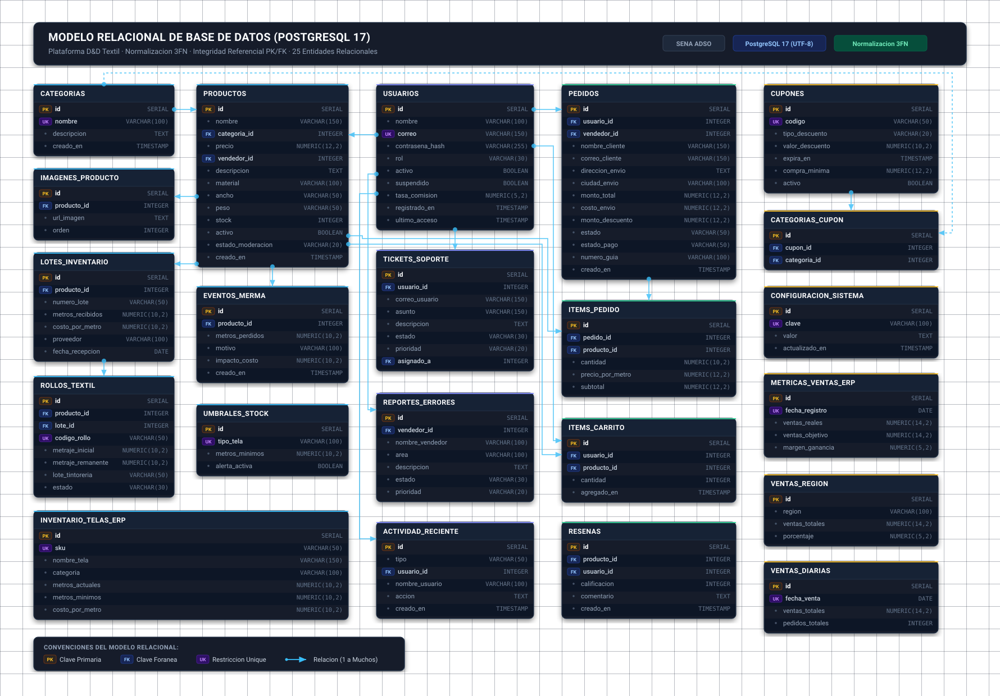
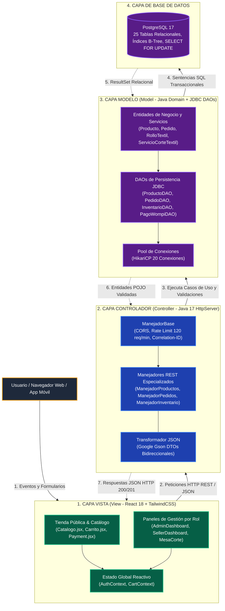
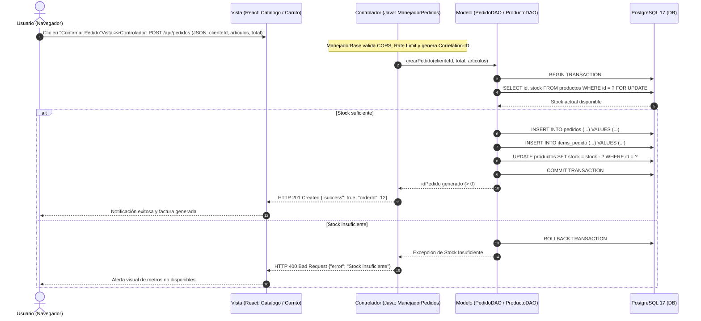

# Diseno, Estructura y Esquema de Base de Datos Relacional
**Proyecto:** Plataforma Distribuida de Comercializacion y Control Logistico Textil (D&D Textil)  
**Programa de Formacion:** Tecnologo en Analisis y Desarrollo de Software (ADSO) - SENA  
**Motor de Base de Datos:** PostgreSQL 17 (Codificacion UTF-8)  
**Version:** 2.0.0 - Documentacion Tecnica Oficial  

---

## 1. Diseno Arquitectonico de la Base de Datos

El modelo de datos de **D&D Textil** esta implementado sobre el motor relacional **PostgreSQL 17**, optimizado para garantizar la integridad transaccional (ACID), alta concurrencia mediante bloqueos a nivel de fila y consistencia estricta en el inventario fisico de telas.

### Principios de Diseno Aplicados:
1. **Normalizacion hasta Tercera Forma Normal (3FN):** Se eliminaron redundancias en catalogos, cupones y transacciones, manteniendo claves foraneas con restricciones de integridad referencial (`ON DELETE CASCADE` o `ON DELETE SET NULL` segun corresponda).
2. **Precision Decimal en Metrajes y Moneda:** Los precios y valores monetarios se modelan con el tipo `NUMERIC(12,2)` para prevenir errores de coma flotante en pesos colombianos (COP). Las longitudes de metraje de telas se modelan con `NUMERIC(10,2)` permitiendo fraccionamientos exactos de dos decimales (centimetros).
3. **Manejo Seguro de Identificadores y Seguridad:** Las contrasenas se almacenan en campos `VARCHAR(255)` que albergan el hash SHA-256 generado en UTF-8. No se almacena ninguna informacion referente a tarjetas de credito o claves bancarias (cumplimiento PCI-DSS).

---

## 2. Modelo Relacional y Diagrama Entidad-Relación (DER)

El modelo relacional traduce los requerimientos del negocio textil a un conjunto de relaciones normalizadas en **Tercera Forma Normal (3FN)**, garantizando atomicidad, eliminación de redundancias y consistencia de claves primarias y foráneas.

### 2.1. Diagrama Gráfico Vectorial del Modelo Relacional

A continuación se presenta el **esquema gráfico completo** de las 25 tablas relacionales organizadas por clústeres de negocio (Catálogo Textil, Usuarios y Seguridad, Ventas y Transacciones, Cupones y Métricas ERP), detallando claves primarias (PK en amarillo), claves foráneas (FK en celeste), restricciones únicas (UK en violeta) y líneas de integridad referencial:



> **Nota:** Puedes hacer clic o abrir directamente el archivo vectorial en alta definición: [modelo_relacional.svg](diagramas/modelo_relacional.svg).

---

### 2.2. Notación Formal del Esquema Relacional

En la notación relacional estándar (Codd / Date), cada entidad o tabla se define con sus atributos, identificando las claves primarias (**PK**) subrayadas y las claves foráneas (**FK**) que establecen integridad referencial hacia sus tablas destino:

1. **`CATEGORIAS`**  
   `CATEGORIAS(`<u>`id`</u>, `nombre` [UK], `descripcion`, `creado_en`)

2. **`USUARIOS`**  
   `USUARIOS(`<u>`id`</u>, `nombre`, `correo` [UK], `contrasena_hash`, `rol`, `activo`, `suspendido`, `motivo_suspension`, `tasa_comision`, `registrado_en`, `ultimo_acceso`)

3. **`PRODUCTOS`**  
   `PRODUCTOS(`<u>`id`</u>, `nombre`, `categoria_id` [FK &rarr; `CATEGORIAS.id`], `precio`, `vendedor_id` [FK &rarr; `USUARIOS.id`], `descripcion`, `material`, `ancho`, `peso`, `cuidados`, `stock`, `destacado`, `activo`, `estado_moderacion`, `motivo_rechazo`, `es_nueva_coleccion`, `es_exclusivo`, `es_oferta`, `creado_en`, `actualizado_en`)

4. **`IMAGENES_PRODUCTO`**  
   `IMAGENES_PRODUCTO(`<u>`id`</u>, `producto_id` [FK &rarr; `PRODUCTOS.id`], `url_imagen`, `orden_visualizacion`)

5. **`LOTES_INVENTARIO`**  
   `LOTES_INVENTARIO(`<u>`id`</u>, `producto_id` [FK &rarr; `PRODUCTOS.id`], `numero_lote`, `metros_recibidos`, `costo_por_metro`, `proveedor`, `fecha_recepcion`, `notas`, `creado_en`)

6. **`ROLLOS_TEXTIL`**  
   `ROLLOS_TEXTIL(`<u>`id`</u>, `producto_id` [FK &rarr; `PRODUCTOS.id`], `lote_id` [FK &rarr; `LOTES_INVENTARIO.id`], `codigo_rollo` [UK], `metraje_inicial`, `metraje_remanente`, `lote_tintoreria`, `estado`, `ubicacion_bodega`)

7. **`EVENTOS_MERMA`**  
   `EVENTOS_MERMA(`<u>`id`</u>, `producto_id` [FK &rarr; `PRODUCTOS.id`], `metros_perdidos`, `motivo`, `impacto_costo`, `creado_en`)

8. **`UMBRALES_STOCK`**  
   `UMBRALES_STOCK(`<u>`id`</u>, `tipo_tela` [UK], `metros_minimos`, `alerta_activa`)

9. **`CUPONES`**  
   `CUPONES(`<u>`id`</u>, `codigo` [UK], `code`, `tipo_descuento`, `valor_descuento`, `expira_en`, `compra_minima`, `usos_maximos`, `solo_primera_vez`, `conteo_usos`, `activo`, `active`, `creado_en`)

10. **`CATEGORIAS_CUPON`**  
    `CATEGORIAS_CUPON(`<u>`id`</u>, `cupon_id` [FK &rarr; `CUPONES.id`], `categoria_id` [FK &rarr; `CATEGORIAS.id`])

11. **`PEDIDOS`**  
    `PEDIDOS(`<u>`id`</u>, `usuario_id` [FK &rarr; `USUARIOS.id`], `vendedor_id` [FK &rarr; `USUARIOS.id`], `nombre_cliente`, `correo_cliente`, `telefono_cliente`, `direccion_envio`, `ciudad_envio`, `departamento_envio`, `monto_total`, `subtotal`, `monto_impuesto`, `costo_envio`, `monto_descuento`, `codigo_cupon`, `estado`, `metodo_pago`, `estado_pago`, `numero_guia`, `notas`, `creado_en`, `actualizado_en`)

12. **`ITEMS_PEDIDO`**  
    `ITEMS_PEDIDO(`<u>`id`</u>, `pedido_id` [FK &rarr; `PEDIDOS.id`], `producto_id` [FK &rarr; `PRODUCTOS.id`], `cantidad`, `precio_por_metro`, `subtotal`)

13. **`ITEMS_CARRITO`**  
    `ITEMS_CARRITO(`<u>`id`</u>, `usuario_id` [FK &rarr; `USUARIOS.id`], `producto_id` [FK &rarr; `PRODUCTOS.id`], `cantidad`, `agregado_en`, `actualizado_en`)

14. **`RESENAS`**  
    `RESENAS(`<u>`id`</u>, `producto_id` [FK &rarr; `PRODUCTOS.id`], `usuario_id` [FK &rarr; `USUARIOS.id`], `calificacion`, `comentario`, `creado_en`)

15. **`TICKETS_SOPORTE`**  
    `TICKETS_SOPORTE(`<u>`id`</u>, `usuario_id` [FK &rarr; `USUARIOS.id`], `nombre_usuario`, `correo_usuario`, `asunto`, `descripcion`, `estado`, `prioridad`, `asignado_a` [FK &rarr; `USUARIOS.id`], `creado_en`, `actualizado_en`, `resuelto_en`)

16. **`REPORTES_ERRORES`**  
    `REPORTES_ERRORES(`<u>`id`</u>, `vendedor_id` [FK &rarr; `USUARIOS.id`], `nombre_vendedor`, `area`, `descripcion`, `pasos`, `estado`, `prioridad`, `asignado_a` [FK &rarr; `USUARIOS.id`], `reportado_en`, `resuelto_en`)

17. **`CONFIGURACION_SISTEMA`**  
    `CONFIGURACION_SISTEMA(`<u>`id`</u>, `clave` [UK], `valor`, `actualizado_en`)

18. **`SECCIONES_INICIO`**  
    `SECCIONES_INICIO(`<u>`id`</u>, `clave` [UK], `titulo`, `subtitulo`, `activo`, `orden`, `creado_en`, `active`)

19. **`DIAPOSITIVAS_CARRUSEL`**  
    `DIAPOSITIVAS_CARRUSEL(`<u>`id`</u>, `titulo`, `subtitulo`, `imagen`, `cta`, `clave_seccion`, `activo`, `orden`, `creado_en`, `image`, `active`)

20. **`BANNER_GLOBAL`**  
    `BANNER_GLOBAL(`<u>`id`</u>, `activo`, `mensaje`, `tipo_banner`, `actualizado_en`)

21. **`METRICAS_VENTAS_ERP`**  
    `METRICAS_VENTAS_ERP(`<u>`id`</u>, `fecha_registro` [UK], `ventas_reales`, `ventas_objetivo`, `margen_ganancia`, `creado_en`)

22. **`VENTAS_DIARIAS`**  
    `VENTAS_DIARIAS(`<u>`id`</u>, `fecha_venta` [UK], `ventas_totales`, `pedidos_totales`, `creado_en`)

23. **`VENTAS_REGION`**  
    `VENTAS_REGION(`<u>`id`</u>, `region`, `ventas_totales`, `porcentaje`, `creado_en`)

24. **`ACTIVIDAD_RECIENTE`**  
    `ACTIVIDAD_RECIENTE(`<u>`id`</u>, `tipo`, `usuario_id` [FK &rarr; `USUARIOS.id`], `nombre_usuario`, `accion`, `creado_en`)

25. **`NOTIFICACIONES_SISTEMA_ERP`**  
    `NOTIFICACIONES_SISTEMA_ERP(`<u>`id`</u>, `tipo`, `titulo`, `mensaje`, `leido`, `creado_en`, `type`)

26. **`INVENTARIO_TELAS_ERP`**  
    `INVENTARIO_TELAS_ERP(`<u>`id`</u>, `sku` [UK], `nombre_tela`, `categoria`, `proveedor`, `metros_actuales`, `metros_minimos`, `costo_por_metro`, `fecha_ultima_reposicion`)

---

### 2.2. Diagrama Entidad-Relacion (DER)

A continuación se presenta el **Diagrama Entidad-Relación (DER)** modelado en sintaxis Mermaid, organizado por clústeres de negocio y conectando el ciclo de compra con la auditoría de pasarela Wompi:

```mermaid
erDiagram
    %% Relaciones de Usuarios y Clientes
    USUARIOS ||--o{ PRODUCTOS : "publica (vendedor)"USUARIOS ||--o{ PEDIDOS : "realiza (cliente)"USUARIOS ||--o{ PEDIDOS : "gestiona (vendedor)"USUARIOS ||--o{ ITEMS_CARRITO : "posee"USUARIOS ||--o{ RESENAS : "escribe"USUARIOS ||--o{ TICKETS_SOPORTE : "radica"%% Relaciones de Catálogo e Inventario
    CATEGORIAS ||--o{ PRODUCTOS : "clasifica"PRODUCTOS ||--o{ IMAGENES_PRODUCTO : "contiene"PRODUCTOS ||--o{ LOTES_INVENTARIO : "abastecido_por"PRODUCTOS ||--o{ EVENTOS_MERMA : "registra"PRODUCTOS ||--o{ ITEMS_PEDIDO : "incluido_en"PRODUCTOS ||--o{ ITEMS_CARRITO : "agregado_en"PRODUCTOS ||--o{ RESENAS : "recibe"LOTES_INVENTARIO ||--o{ ROLLOS_TEXTIL : "genera_rollos"%% Relaciones Comerciales y Pagos
    PEDIDOS ||--|{ ITEMS_PEDIDO : "contiene"PEDIDOS ||--o{ EVENTOS_PAGO_WOMPI : "audita_transacciones"CUPONES ||--o{ CATEGORIAS_CUPON : "restringe"CATEGORIAS ||--o{ CATEGORIAS_CUPON : "aplica_a"USUARIOS {
        int id PK
        string nombre
        string correo UK
        string contrasena_hash
        string rol
        boolean activo
        boolean suspendido
        numeric tasa_comision
        timestamp registrado_en
    }

    CATEGORIAS {
        int id PK
        string nombre UK
        text descripcion
        timestamp creado_en
    }

    PRODUCTOS {
        int id PK
        string nombre
        int categoria_id FK
        numeric precio
        int vendedor_id FK
        string material
        string ancho
        string peso
        int stock
        boolean destacado
        boolean activo
    }

    LOTES_INVENTARIO {
        int id PK
        int producto_id FK
        string numero_lote
        numeric metros_recibidos
        numeric costo_por_metro
        string proveedor
        date fecha_recepcion
    }

    ROLLOS_TEXTIL {
        int id PK
        int producto_id FK
        int lote_id FK
        string codigo_rollo UK
        numeric metraje_inicial
        numeric metraje_remanente
        string lote_tintoreria
        string estado
        string ubicacion_bodega
    }

    EVENTOS_MERMA {
        int id PK
        int producto_id FK
        numeric metros_perdidos
        string motivo
        numeric impacto_costo
        timestamp creado_en
    }

    PEDIDOS {
        int id PK
        int usuario_id FK
        int vendedor_id FK
        string nombre_cliente
        string correo_cliente
        string telefono_cliente
        text direccion_envio
        string ciudad_envio
        numeric monto_total
        numeric subtotal
        numeric costo_envio
        string estado
        string estado_pago
        string numero_guia
        timestamp creado_en
    }

    ITEMS_PEDIDO {
        int id PK
        int pedido_id FK
        int producto_id FK
        numeric cantidad
        numeric precio_por_metro
        numeric subtotal
    }

    EVENTOS_PAGO_WOMPI {
        int id PK
        string wompi_transaccion_id
        string referencia FK
        string estado
        numeric monto_en_centavos
        boolean checksum_valido
        timestamp creado_en
    }

    CUPONES {
        int id PK
        string codigo UK
        string tipo_descuento
        numeric valor_descuento
        numeric compra_minima
        boolean activo
        timestamp expira_en
    }
```

---

## 3. Diccionario de Datos Exhaustivo

### 3.1. Tabla: `usuarios`
Gestiona las credenciales y perfiles de acceso bajo el modelo RBAC.
| Nombre de Columna | Tipo de Dato | Tamano | Nulo | Restriccion | Descripcion Tecnica y de Negocio |
| :--- | :--- | :---: | :---: | :---: | :--- |
| `id` | `SERIAL` | 4 B | NO | **PK** | Identificador secuencial primario de usuario. |
| `nombre` | `VARCHAR` | 100 | NO | - | Nombre y apellido o razon social de la empresa. |
| `correo` | `VARCHAR` | 150 | NO | **UK** | Direccion de correo electronico corporativo o personal. |
| `contrasena_hash` | `VARCHAR` | 255 | NO | - | Hash criptografico SHA-256 generado en codificacion UTF-8. |
| `rol` | `VARCHAR` | 50 | NO | - | Rol de autorizacion: `cliente`, `vendedor`, `operario_corte`, `administrador`. |
| `activo` | `BOOLEAN` | 1 B | NO | - | Estado de habilitacion de la cuenta en el sistema. |
| `suspendido` | `BOOLEAN` | 1 B | NO | - | Indicador de bloqueo disciplinario de la cuenta. |
| `motivo_suspension` | `TEXT` | Variable | SI | - | Justificacion de la suspension emitida por el administrador. |
| `tasa_comision` | `NUMERIC` | 5,2 | SI | - | Porcentaje de comision pactada con el vendedor (ej. 5.50%). |
| `registrado_en` | `TIMESTAMP` | 8 B | NO | - | Marca temporal exacta de creacion de la cuenta. |
| `ultimo_acceso` | `TIMESTAMP` | 8 B | SI | - | Fecha y hora del inicio de sesion exitoso mas reciente. |

### 3.2. Tabla: `categorias`
Clasificacion de tejidos segun su origen y caracteristicas tecnicas.
| Nombre de Columna | Tipo de Dato | Tamano | Nulo | Restriccion | Descripcion Tecnica y de Negocio |
| :--- | :--- | :---: | :---: | :---: | :--- |
| `id` | `SERIAL` | 4 B | NO | **PK** | Identificador primario de la categoria. |
| `nombre` | `VARCHAR` | 100 | NO | **UK** | Nombre unico de la categoria (Algodon, Seda, Lino, etc.). |
| `descripcion` | `TEXT` | Variable | SI | - | Descripcion general de las aplicaciones del tejido. |
| `creado_en` | `TIMESTAMP` | 8 B | NO | - | Fecha de registro de la categoria. |

### 3.3. Tabla: `productos`
Catalogo maestro de telas disponibles para la venta.
| Nombre de Columna | Tipo de Dato | Tamano | Nulo | Restriccion | Descripcion Tecnica y de Negocio |
| :--- | :--- | :---: | :---: | :---: | :--- |
| `id` | `SERIAL` | 4 B | NO | **PK** | Identificador primario de la tela. |
| `nombre` | `VARCHAR` | 200 | NO | - | Nombre comercial del tejido (ej. "Lino Italiano Puro"). |
| `categoria_id` | `INTEGER` | 4 B | SI | **FK** | Referencia a `categorias(id)`. |
| `precio` | `NUMERIC` | 12,2 | NO | - | Precio base de venta por metro lineal en pesos colombianos (COP). |
| `vendedor_id` | `INTEGER` | 4 B | SI | **FK** | Referencia a `usuarios(id)` propietario de la tela. |
| `descripcion` | `TEXT` | Variable | SI | - | Descripcion comercial y tactil del tejido. |
| `material` | `VARCHAR` | 100 | SI | - | Composicion porcentual de fibras (ej. 100% Algodon Peinado). |
| `ancho` | `VARCHAR` | 50 | SI | - | Ancho util del rollo expresado en metros (ej. "1.50 metros"). |
| `peso` | `VARCHAR` | 50 | SI | - | Gramaje del tejido expresado en gramos por metro cuadrado (ej. "240 g/m2"). |
| `cuidados` | `TEXT` | Variable | SI | - | Recomendaciones de lavado, planchado y secado. |
| `stock` | `INTEGER` | 4 B | NO | - | Existencia fisica agregada en metros lineales. |
| `destacado` | `BOOLEAN` | 1 B | NO | - | Indicador para exhibicion en pagina principal. |
| `activo` | `BOOLEAN` | 1 B | NO | - | Visibilidad en catalogo publico. |
| `estado_moderacion` | `VARCHAR` | 50 | NO | - | Estado de aprobacion: `pending`, `approved`, `rejected`. |
| `motivo_rechazo` | `TEXT` | Variable | SI | - | Justificacion en caso de rechazo de publicacion. |
| `es_nueva_coleccion` | `BOOLEAN` | 1 B | NO | - | Marcador para colecciones de temporada. |
| `es_exclusivo` | `BOOLEAN` | 1 B | NO | - | Marcador para telas importadas o de edicion limitada. |
| `es_oferta` | `BOOLEAN` | 1 B | NO | - | Marcador de precios promocionales de descuento. |

### 3.4. Tabla: `rollos_textil`
Registro de unidades fisicas individuales para trazabilidad de corte y tintoreria.
| Nombre de Columna | Tipo de Dato | Tamano | Nulo | Restriccion | Descripcion Tecnica y de Negocio |
| :--- | :--- | :---: | :---: | :---: | :--- |
| `id` | `SERIAL` | 4 B | NO | **PK** | Identificador primario del rollo fisico. |
| `producto_id` | `INTEGER` | 4 B | NO | **FK** | Referencia a `productos(id)`. |
| `lote_id` | `INTEGER` | 4 B | NO | **FK** | Referencia a `lotes_inventario(id)`. |
| `codigo_rollo` | `VARCHAR` | 50 | NO | **UK** | Codigo escaneable de barras o QR (ej. "ROL-2026-0089"). |
| `metraje_inicial` | `NUMERIC` | 10,2 | NO | - | Metros lineales de fabricacion al ingresar a bodega. |
| `metraje_remanente` | `NUMERIC` | 10,2 | NO | - | Metros lineales disponibles actualmente para corte. |
| `lote_tintoreria` | `VARCHAR` | 50 | NO | - | Partida quimica de tintura (ej. "TINT-AZUL-L44"). |
| `estado` | `VARCHAR` | 30 | NO | - | Estado: `disponible`, `reservado`, `retazo_liquidado`, `agotado`. |
| `ubicacion_bodega` | `VARCHAR` | 50 | SI | - | Posicion en estanteria (ej. "EST-04-NIVEL-2"). |

### 3.5. Tabla: `lotes_inventario`
Control de entradas masivas de tejidos provistos por fabricantes.
| Nombre de Columna | Tipo de Dato | Tamano | Nulo | Restriccion | Descripcion Tecnica y de Negocio |
| :--- | :--- | :---: | :---: | :---: | :--- |
| `id` | `SERIAL` | 4 B | NO | **PK** | Identificador del lote de compra. |
| `producto_id` | `INTEGER` | 4 B | NO | **FK** | Referencia a `productos(id)`. |
| `numero_lote` | `VARCHAR` | 50 | NO | - | Codigo de remision del fabricante. |
| `metros_recibidos` | `NUMERIC` | 10,2 | NO | - | Total de metros lineales adquiridos en la partida. |
| `costo_por_metro` | `NUMERIC` | 10,2 | NO | - | Costo de compra por metro para calculo de margenes. |
| `proveedor` | `VARCHAR` | 100 | SI | - | Nombre o razon social del fabricante textil. |
| `fecha_recepcion` | `DATE` | 4 B | NO | - | Fecha de entrada a bodega. |

### 3.6. Tabla: `eventos_merma`
Historico de desperdicios y reclasificaciones automaticas de retazos sub-metro.
| Nombre de Columna | Tipo de Dato | Tamano | Nulo | Restriccion | Descripcion Tecnica y de Negocio |
| :--- | :--- | :---: | :---: | :---: | :--- |
| `id` | `SERIAL` | 4 B | NO | **PK** | Identificador del registro de desperdicio. |
| `producto_id` | `INTEGER` | 4 B | NO | **FK** | Referencia a `productos(id)`. |
| `metros_perdidos` | `NUMERIC` | 10,2 | NO | - | Metros lineales dados de baja del inventario comercial. |
| `motivo` | `VARCHAR` | 100 | NO | - | Causa: `remanente_sub_metro`, `corte_defectuoso`, `mancha_fabrica`. |
| `impacto_costo` | `NUMERIC` | 10,2 | SI | - | Valorizacion monetaria de la perdida segun costo de lote. |
| `creado_en` | `TIMESTAMP` | 8 B | NO | - | Fecha y hora en la que ocurrio el evento. |

### 3.7. Tabla: `pedidos`
Encabezado de ordenes comerciales de compra.
| Nombre de Columna | Tipo de Dato | Tamano | Nulo | Restriccion | Descripcion Tecnica y de Negocio |
| :--- | :--- | :---: | :---: | :---: | :--- |
| `id` | `SERIAL` | 4 B | NO | **PK** | Numero de orden de pedido unico. |
| `usuario_id` | `INTEGER` | 4 B | SI | **FK** | Cuenta del cliente comprador en `usuarios(id)`. |
| `nombre_cliente` | `VARCHAR` | 150 | NO | - | Nombre del destinatario del pedido. |
| `correo_cliente` | `VARCHAR` | 150 | NO | - | Correo para notificaciones transaccionales. |
| `telefono_cliente` | `VARCHAR` | 50 | SI | - | Telefono movil para la transportadora. |
| `direccion_envio` | `TEXT` | Variable | NO | - | Direccion fisica completa de entrega. |
| `ciudad_envio` | `VARCHAR` | 100 | SI | - | Municipio de entrega (ej. Medellin, Bogota, Cali). |
| `departamento_envio` | `VARCHAR` | 100 | SI | - | Departamento de entrega en territorio colombiano. |
| `monto_total` | `NUMERIC` | 12,2 | NO | - | Importe final pagado por el cliente en COP. |
| `subtotal` | `NUMERIC` | 12,2 | SI | - | Valor de telas antes de flete y descuentos. |
| `costo_envio` | `NUMERIC` | 12,2 | SI | - | Costo liquidado de transporte. |
| `monto_descuento` | `NUMERIC` | 12,2 | SI | - | Rebaja monetaria por cupon o escala mayorista. |
| `codigo_cupon` | `VARCHAR` | 50 | SI | - | Codigo promocional aplicado. |
| `estado` | `VARCHAR` | 50 | NO | - | Estado operativo: `pending`, `cutting`, `shipped`, `delivered`, `cancelled`. |
| `estado_pago` | `VARCHAR` | 50 | NO | - | Estado de cobro: `pending`, `paid`, `refunded`, `failed`. |
| `numero_guia` | `VARCHAR` | 100 | SI | - | Codigo de rastreo o identificador QR de corte. |

### 3.8. Tabla: `items_pedido`
Detalle de las telas y metrajes contenidos en cada pedido.
| Nombre de Columna | Tipo de Dato | Tamano | Nulo | Restriccion | Descripcion Tecnica y de Negocio |
| :--- | :--- | :---: | :---: | :---: | :--- |
| `id` | `SERIAL` | 4 B | NO | **PK** | Identificador de la linea de pedido. |
| `pedido_id` | `INTEGER` | 4 B | NO | **FK** | Referencia a `pedidos(id)`. |
| `producto_id` | `INTEGER` | 4 B | SI | **FK** | Referencia a `productos(id)`. |
| `cantidad` | `NUMERIC` | 10,2 | NO | - | Metros lineales solicitados. |
| `precio_por_metro` | `NUMERIC` | 12,2 | NO | - | Precio unitario aplicado a la linea segun volumen. |
| `subtotal` | `NUMERIC` | 12,2 | NO | - | Valor total de la linea (`cantidad * precio_por_metro`). |

---

## 4. Indices de Rendimiento y Optimizacion de Consultas

Para cumplir con el requerimiento de tiempo de respuesta **$p95 \le 200\text{ ms}$** bajo alta concurrencia, la base de datos cuenta con los siguientes indices B-Tree estrategicos:

```sql
-- Indice unico para busqueda inmediata de usuario por correo
CREATE UNIQUE INDEX IF NOT EXISTS idx_usuarios_correo ON usuarios(correo);

-- Indice para filtrado de telas por categoria activa
CREATE INDEX IF NOT EXISTS idx_productos_categoria_activo ON productos(categoria_id, activo);

-- Indice para ordenamiento de catalogo por precio
CREATE INDEX IF NOT EXISTS idx_productos_precio ON productos(precio);

-- Indice para consultas de rollos disponibles por producto y lote de tintoreria
CREATE INDEX IF NOT EXISTS idx_rollos_producto_lote ON rollos_textil(producto_id, lote_tintoreria, estado);

-- Indice para historial de pedidos por usuario
CREATE INDEX IF NOT EXISTS idx_pedidos_usuario_fecha ON pedidos(usuario_id, creado_en DESC);

-- Indice para busqueda de items de un pedido
CREATE INDEX IF NOT EXISTS idx_items_pedido_pedido ON items_pedido(pedido_id);
```

---

## 5. Scripts de Inicializacion Oficiales

Los scripts ejecutables de creacion de tablas, claves foraneas y datos iniciales de prueba con contrasenas encriptadas se encuentran ubicados en la carpeta raíz del repositorio:
1. `BASE DE DATOS/01_esquema_espanol.sql`: Definicion del esquema DDL completo de todas las tablas y relaciones.
2. `BASE DE DATOS/02_datos_iniciales.sql`: Carga de categorias, telas de prueba, usuarios con perfiles predeterminados y roles.
3. `BASE DE DATOS/README.md`: Documento de especificacion tecnica del modelo relacional formal, vistas SQL y arquitectura MVC.

---

## 6. Integración con la Arquitectura Modelo-Vista-Controlador (MVC)

El sistema **D&D Textil** implementa el patrón arquitectónico **Modelo-Vista-Controlador (MVC)** desacoplado para aplicaciones web y móviles distribuidas (ADSO - SENA), garantizando una estricta separación de responsabilidades:

### 6.1. Diagrama Gráfico Vectorial de la Arquitectura MVC

El siguiente diagrama visual ilustra la arquitectura de tres capas, los componentes de software de cada capa, los canales de comunicación HTTP REST/JSON y JDBC, y el flujo de datos transaccional:


> **Nota:** Puedes hacer clic o abrir directamente el archivo vectorial en alta definición: [arquitectura_mvc.svg](diagramas/arquitectura_mvc.svg).

---

### 6.2. Diagrama de Flujo Arquitectónico MVC (Interacción entre Capas)

A continuación se ilustra la arquitectura de interacción desacoplada entre la **Vista**, el **Controlador**, el **Modelo** y el motor **PostgreSQL 17**, estructurada en un flujo bidireccional limpio (Petición descendente y Respuesta ascendente):



---

### 6.3. Componente M: El Modelo (Model)

El **Modelo** es el núcleo de la lógica de negocio y la persistencia de datos. Contiene los datos puros, las reglas de integridad y el acceso a la base de datos:

1. **Persistencia Relacional (PostgreSQL 17):**
   * Almacenamiento seguro, índices B-Tree de alto rendimiento, transacciones ACID y bloqueos a nivel de fila (`SELECT ... FOR UPDATE`) para evitar condiciones de carrera en compras simultáneas de tela.
2. **Entidades de Dominio (`dominio.modelos.*`):**
   * Clases Java encapsuladas (`Producto`, `Pedido`, `Usuario`, `ItemCarrito`, `LoteInventario`, `UmbralStock`, `VentaRegion`, `ActividadReciente`).
   * Manejo bilingüe con anotaciones `@SerializedName` de Google Gson para serialización transparente.
3. **Objetos de Acceso a Datos (`infraestructura.persistencia.jdbc.*`):**
   * DAOs especializados (`ProductoDAO`, `PedidoDAO`, `InventarioDAO`, `CarritoDAO`, `UsuarioDAO`, `CuponDAO`).
   * Consultas SQL parametrizadas mediante `PreparedStatement` para mitigar ataques de inyección SQL (OWASP Top 10).

### 6.4. Componente V: La Vista (View)

La **Vista** es la interfaz visual reactiva con la que interactúan los diferentes actores del sistema (Clientes, Vendedores, Administradores):

1. **Frontend React 18 + Vite:**
   * Estructura SPA (Single Page Application) modular y desacoplada del backend.
   * Estilizado con Tailwind CSS bajo principios de ergonomía visual y accesibilidad (WCAG 2.1).
2. **Componentes Clave de Vista:**
   * `src/paginas/Catalogo.jsx`: Renderizado del catálogo textil con filtros dinámicos por tipo de tela y precio.
   * `src/componentes/CarritoDrawer.jsx`: Carrito lateral interactivo con cálculo automático de totales y cupones.
   * `src/paginas/admin/ResumenAdmin.jsx`: Panel de control con gráficos Recharts para métricas comerciales.
   * `src/paginas/admin/Inventario/ConfiguracionStock.jsx`: Vista de configuración de umbrales y alertas de stock.
3. **Consumo Desacoplado:**
   * La Vista no accede jamás de forma directa a la base de datos; delega toda obtención de información mediante peticiones asíncronas `fetch()` hacia la API REST.

### 6.5. Componente C: El Controlador (Controller)

El **Controlador** actúa como puente intermediario e inteligente entre la Vista y el Modelo. Recibe las peticiones HTTP, orquesta las validaciones de seguridad y coordina el flujo de respuesta:

1. **Manejador Base (`ManejadorBase.java`):**
   * Hereda de `HttpHandler` del servidor embebido de Java.
   * Aplica políticas DevSecOps globales: cabeceras CORS dinámicas, Rate Limiting per cápita (120 req/min por IP), inyección de `X-Correlation-ID` para trazabilidad y logs estructurados en JSON.
2. **Controladores Especializados (`infraestructura.api.manejadores.*`):**
   * `ManejadorProductos`: Gestiona las rutas `/api/productos` (GET, POST, PUT, DELETE).
   * `ManejadorPedidos`: Orquesta la creación transaccional de órdenes, validando stock disponible y calculando totales con impuestos.
   * `ManejadorInventario`: Procesa métricas de lotes, mermas, umbrales y ventas regionales.
   * `ManejadorCarrito`: Gestiona las adiciones, actualizaciones y vaciado del carrito de compras.
   * `ManejadorSalud`: Expone `/health/live` y `/health/ready` para auditoría y observabilidad en Docker.

### 6.6. Vistas de Base de Datos (SQL Views)

En PostgreSQL, las **Vistas** encapsulan consultas complejas de agregación y reportes, optimizando la interfaz entre el Modelo y el Controlador:

#### Vista 1: Catálogo Consolidado de Telas con Imágenes
```sql
CREATE OR REPLACE VIEW vista_catalogo_telas AS
SELECT 
    p.id AS producto_id,
    p.nombre AS nombre_tela,
    c.nombre AS categoria,
    p.precio,
    p.stock AS metros_disponibles,
    p.material,
    p.ancho,
    u.nombre AS vendedor,
    (SELECT ip.url_imagen 
     FROM imagenes_producto ip 
     WHERE ip.producto_id = p.id 
     ORDER BY ip.orden_visualizacion ASC LIMIT 1) AS imagen_principal,
    COALESCE(AVG(r.calificacion), 5.0) AS calificacion_promedio,
    COUNT(r.id) AS total_resenas
FROM productos p
JOIN categorias c ON p.categoria_id = c.id
LEFT JOIN usuarios u ON p.vendedor_id = u.id
LEFT JOIN resenas r ON p.id = r.producto_id
WHERE p.activo = true AND p.estado_moderacion = 'approved'
GROUP BY p.id, c.nombre, u.nombre;
```

#### Vista 2: Alertas de Stock Crítico de Inventario
```sql
CREATE OR REPLACE VIEW vista_alertas_stock_critico AS
SELECT 
    p.id AS producto_id,
    p.nombre AS nombre_tela,
    p.stock AS metros_actuales,
    COALESCE(u.metros_minimos, 20.0) AS umbral_minimo,
    CASE 
        WHEN p.stock <= 0 THEN 'AGOTADO'
        WHEN p.stock <= COALESCE(u.metros_minimos, 20.0) THEN 'CRITICO'
        ELSE 'OPTIMO'
    END AS estado_alerta
FROM productos p
LEFT JOIN umbrales_stock u ON p.nombre = u.tipo_tela OR p.material = u.tipo_tela
WHERE p.activo = true;
```

#### Vista 3: Resumen de Ventas por Vendedor
```sql
CREATE OR REPLACE VIEW vista_ventas_vendedores AS
SELECT 
    u.id AS vendedor_id,
    u.nombre AS vendedor_nombre,
    u.correo AS vendedor_correo,
    COUNT(DISTINCT p.id) AS total_pedidos,
    COALESCE(SUM(ip.subtotal), 0.00) AS total_ventas,
    COALESCE(SUM(ip.subtotal * (u.tasa_comision / 100.0)), 0.00) AS comisiones_acumuladas
FROM usuarios u
LEFT JOIN pedidos p ON p.vendedor_id = u.id AND p.estado NOT IN ('cancelled', 'refunded')
LEFT JOIN items_pedido ip ON ip.pedido_id = p.id
WHERE u.rol = 'vendedor'
GROUP BY u.id, u.nombre, u.correo;
```

### 6.7. Ciclo de Vida Transaccional MVC (Ejemplo: Compra y Descuento de Stock)

A continuación se ilustra la interacción coordinada entre la Vista, el Controlador, el Modelo y la Base de Datos PostgreSQL:


