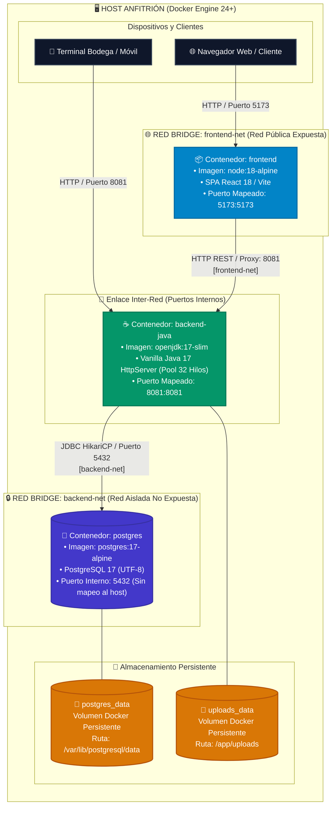

# Manual Tecnico de Instalacion, Configuracion y Despliegue
**Proyecto:** Plataforma Distribuida de Comercializacion y Control Logistico Textil (D&D Textil)  
**Programa de Formacion:** Tecnologo en Analisis y Desarrollo de Software (ADSO) - SENA  
**Version:** 2.0.0 - Documentacion Tecnica Oficial  
**Clasificacion:** Manual de Infraestructura y Operaciones  

---

## 1. Requisitos de Infraestructura del Sistema

Para garantizar el desempeno optimo, la estabilidad y la resiliencia operativa de la plataforma **D&D Textil**, el entorno de despliegue debe cumplir con los siguientes parametros de hardware y software:

### 1.1. Requisitos de Hardware

| Componente | Entorno de Desarrollo Local | Entorno de Produccion Recomendado |
| :--- | :--- | :--- |
| **Procesador (CPU)** | 2 nucleos x86_64 o ARM64 (2.0 GHz o superior) | 4 nucleos x86_64 (2.8 GHz o superior) |
| **Memoria RAM** | 4 GB de memoria fisica disponible | 8 GB de memoria fisica (ECC recomendado) |
| **Almacenamiento** | 10 GB de espacio libre en disco (SSD) | 40 GB de almacenamiento en estado solido (NVMe) |
| **Conectividad de Red** | Interfaz local 100 Mbps | 1 Gbps con ancho de banda redundante |
| **Arquitectura de S.O.** | 64 bits (x86_64 / amd64) | 64 bits (x86_64 / amd64) |

### 1.2. Requisitos de Software

| Componente | Version Minima Exigida | Proposito en la Plataforma |
| :--- | :--- | :--- |
| **Sistema Operativo** | Ubuntu Server 22.04 LTS / Windows 10/11 / macOS 12+ | Sistema operativo anfitrion para servicios |
| **Java Development Kit (JDK)** | OpenJDK o Eclipse Temurin 17 LTS | Compilacion y ejecucion del backend Vanilla Java |
| **Node.js** | v18.17.0 LTS o v20.x LTS | Entorno de ejecucion para tooling de frontend |
| **Gestor de Paquetes npm** | v9.6.0 o superior | Resolucion de dependencias de React y TailwindCSS |
| **Motor de Base de Datos** | PostgreSQL 14.x, 15.x, 16.x o 17.x | Persistencia relacional ACID con soporte UTF-8 |
| **Docker Engine** | v24.0.0 o superior | Plataforma de virtualizacion por contenedores |
| **Docker Compose** | v2.20.0 o superior (Plugin CLI v2) | Orquestacion multicontenedor y definicion de redes |
| **Cliente Git** | v2.34.0 o superior | Control de versiones y clonacion del repositorio |

---

## 2. Topologia de Contenedores y Redes en Docker Compose

La arquitectura de despliegue mediante Docker Compose implementa el principio de aislamiento defensivo mediante dos redes virtuales independientes de tipo puente (*bridge*):



```
+-----------------------------------------------------------------------------------+
|                                HOST ANFITRION                                     |
|                                                                                   |
|   Navegador Web / Cliente                     Estacion de Corte / Bodega         |
|         |                                                 |                       |
|         +-----------------------+ +-----------------------+                       |
|                                 | |                                               |
|                                 v v                                               |
|                         [ Puerto 5173 ]                                           |
|                                 |                                                 |
|   +-----------------------------v---------------------------------------------+   |
|   | RED: frontend-net                                                         |   |
|   |                                                                           |   |
|   |   +-----------------------+              +----------------------------+   |   |
|   |   | Contenedor: frontend  |              | Contenedor: backend-java   |   |   |
|   |   | Imagen: node:18-alpine|              | Imagen: openjdk:17-slim    |   |   |
|   |   | Servicio: React/Vite  | ------------>| Servicio: HTTP Server      |   |   |
|   |   | Puerto: 5173          |  (HTTP 8081) | Puerto: 8081               |   |   |
|   |   +-----------------------+              +--------------+-------------+   |   |
|   +---------------------------------------------------------|-----------------+   |
|                                                             |                     |
|   +---------------------------------------------------------|-----------------+   |
|   | RED: backend-net                                        |                 |   |
|   |                                                         v                 |   |
|   |                                          +----------------------------+   |   |
|   |                                          | Contenedor: postgres       |   |   |
|   |                                          | Imagen: postgres:17-alpine |   |   |
|   |                                          | Servicio: PostgreSQL RDBMS |   |   |
|   |                                          | Puerto interno: 5432       |   |   |
|   |                                          +--------------+-------------+   |   |
|   |                                                         |                 |   |
|   +---------------------------------------------------------|-----------------+   |
|                                                             v                     |
|                                                   [ postgres_data ]               |
|                                                   Volumen Persistente             |
+-----------------------------------------------------------------------------------+
```

### 2.1. Politica de Aislamiento de Red
- **`frontend-net`**: Conecta el contenedor de frontend con el puerto HTTP del backend. No tiene visibilidad ni acceso de red al contenedor de base de datos PostgreSQL.
- **`backend-net`**: Conecta exclusivamente el contenedor de backend con el motor PostgreSQL. El frontend no puede comunicarse con esta red, impidiendo ataques directos o vectores de inyeccion que omitan la logica de control de acceso.

---

## 3. Especificacion de Variables de Entorno (`.env`)

El sistema desacopla la configuracion sensible del codigo fuente mediante archivos de variables de entorno. Para iniciar el entorno, se debe crear un archivo `.env` en la raiz del proyecto con la siguiente estructura:

### 3.1. Archivo `.env` Integral del Sistema

```bash
# =============================================================================
# VARIABLES DE CONFIGURACION DE LA BASE DE DATOS (POSTGRESQL)
# =============================================================================
DB_HOST=postgres
DB_PORT=5432
DB_NAME=tienda_textil
DB_USER=postgres
DB_PASSWORD=postgres_secure_password_2026

# =============================================================================
# VARIABLES DE CONFIGURACION DEL BACKEND (JAVA)
# =============================================================================
SERVER_PORT=8081
JWT_SECRET=b8c4d2e8f1a0e9c7b5d3a1f8e6c4b2a0d9e7f5c3b1a9e7f5d3c1b9a7f5e3d1c9
ENVIRONMENT=production
LOG_LEVEL=INFO

# =============================================================================
# VARIABLES DE CONFIGURACION DEL FRONTEND (VITE / REACT)
# =============================================================================
VITE_API_URL=http://localhost:8081
VITE_APP_TITLE="D&D Textil - Tienda Digital de Telas"
```

---

## 4. Despliegue Automatizado con Docker Compose (Recomendado)

El procedimiento de despliegue en contenedores es el metodo estandar y reproducible para poner en marcha la totalidad del ecosistema.

### Paso 1: Clonar el Repositorio de Codigo
```bash
git clone https://github.com/Jhonmoreno000/PROYECTO-SENA-TIENDA-TEXTIL-.git
cd PROYECTO-SENA-TIENDA-TEXTIL-
```

### Paso 2: Crear el Archivo de Variables de Entorno
Copiar la plantilla o crear el archivo `.env` en la raiz:
```bash
cp .env.example .env
```
*(Asegurarse de definir contrasenas seguras para entornos de produccion).*

### Paso 3: Construir e Iniciar los Contenedores
Ejecutar la orquestacion con construccion de imagenes en segundo plano:
```bash
docker compose up --build -d
```

### Paso 4: Validacion del Estado de los Contenedores
Verificar que los tres contenedores se encuentren en estado `Up` y que PostgreSQL reporte estado saludable (`healthy`):
```bash
docker compose ps
```

Salida esperada:
```text
NAME                IMAGE               COMMAND                  SERVICE             STATUS                    PORTS
textil-backend      openjdk:17-slim     "java -cp target:lib…"   backend             Up (healthy)              0.0.0.0:8081->8081/tcp
textil-frontend     node:18-alpine      "npm run dev -- --ho…"   frontend            Up                        0.0.0.0:5173->5173/tcp
textil-postgres     postgres:17-alpine  "docker-entrypoint.s…"   postgres            Up (healthy)              0.0.0.0:5432->5432/tcp
```

### Paso 5: Verificacion de Bitacoras y Logs de Inicio
```bash
docker compose logs -f backend
```

---

## 5. Procedimiento de Instalacion y Ejecucion Manual (Entorno Nativo)

En estaciones de trabajo para desarrollo local donde no se disponga de Docker, la plataforma puede ejecutarse nativamente siguiendo estos pasos:

### 5.1. Inicializacion de la Base de Datos PostgreSQL
1. Abrir la terminal interactiva `psql` con privilegios de superusuario:
   ```bash
   psql -U postgres
   ```
2. Crear la base de datos con codificacion internacional UTF-8:
   ```sql
   CREATE DATABASE tienda_textil WITH ENCODING 'UTF8';
   \c tienda_textil;
   ```
3. Ejecutar los scripts de estructura DDL y datos de prueba:
   ```bash
   psql -U postgres -d tienda_textil -f "tienda digital de telas/backend-java/conexionPostgres/schema.sql"
   ```

### 5.2. Compilacion y Ejecucion del Backend Java
1. Ubicarse en la carpeta del backend:
   ```bash
   cd "tienda digital de telas/backend-java/conexionPostgres"
   ```
2. Crear la carpeta para los binarios compilados:
   ```bash
   mkdir -p bin
   ```
3. Compilar todas las clases del codigo fuente incluyendo las librerias JAR de dependencias (`postgresql-*.jar`, `gson-*.jar`, `HikariCP-*.jar`, `slf4j-*.jar`):
   - En sistemas Linux / macOS:
     ```bash
     javac -encoding UTF-8 -cp "lib/*:src" -d bin $(find src -name "*.java")
     ```
   - En sistemas Microsoft Windows (PowerShell):
     ```powershell
     $jars = (Get-ChildItem -Path "lib\*.jar" | ForEach-Object { $_.FullName }) -join ";"
     $sources = (Get-ChildItem -Path "src" -Recurse -Filter "*.java" | ForEach-Object { $_.FullName })
     javac -encoding UTF-8 -cp "$jars;src" -d bin $sources
     ```
4. Iniciar el servidor HTTP del backend:
   - En Linux / macOS:
     ```bash
     java -cp "bin:lib/*" Servidor
     ```
   - En Windows (PowerShell):
     ```powershell
     java -cp "bin;$jars" Servidor
     ```
5. Salida de inicio exitoso:
   ```text
   ==================================================
   SERVIDOR TEXTIL INICIADO EXITOSAMENTE
   Puerto de Escucha: 8081
   Pool de Conexiones HikariCP: ACTIVO
   Pool de Hilos de Peticiones: 32 hilos concurrentes
   ==================================================
   ```

### 5.3. Instalacion y Ejecucion del Frontend React
1. Ubicarse en el directorio del cliente web:
   ```bash
   cd "tienda digital de telas"
   ```
2. Instalar las dependencias de paquetes de Node.js:
   ```bash
   npm install
   ```
3. Iniciar el servidor de desarrollo en caliente con Vite:
   ```bash
   npm run dev
   ```
4. Abrir en un navegador web la direccion local: `http://localhost:5173`.

---

## 6. Verificacion de Probes de Salud y Monitoreo

La plataforma cuenta con endpoints de diagnostico estandarizados para integracion con orquestadores Kubernetes, Docker Swarm o herramientas de monitoreo como Prometheus:

### 6.1. Probe de Liveness (`/health/live`)
Determina si el proceso Java y el socket HTTP se encuentran vivos y respondiendo:
```bash
curl -i http://localhost:8081/health/live
```
Respuesta HTTP esperada:
```http
HTTP/1.1 200 OK
Content-Type: application/json; charset=UTF-8

{
  "estado": "VIVO",
  "tiempo_actividad_ms": 145020,
  "memoria_usada_mb": 42.8,
  "memoria_total_mb": 128.0
}
```

### 6.2. Probe de Readiness (`/health/ready`)
Determina si el backend tiene conexion activa y funcional contra el pool de la base de datos PostgreSQL:
```bash
curl -i http://localhost:8081/health/ready
```
Respuesta HTTP esperada:
```http
HTTP/1.1 200 OK
Content-Type: application/json; charset=UTF-8

{
  "estado": "LISTO",
  "base_de_datos": "CONECTADA",
  "conexiones_activas": 2,
  "conexiones_inactivas": 8,
  "total_conexiones_pool": 10
}
```

---

## 7. Ejecucion del Plan de Pruebas Automatizadas

El backend incluye suites de pruebas unitarias y de seguridad sin dependencias externas que pueden ejecutarse de manera autonoma para certificar la integridad de las reglas de negocio antes de un paso a produccion:

### 7.1. Pruebas del Motor Textil y Reglas de Negocio
```powershell
java -cp "bin;$jars" PruebasReglasNegocioTextil
```
Salida certificada:
```text
============================================================
EJECUTANDO SUITE DE PRUEBAS: REGLAS DE NEGOCIO TEXTIL (D&D)
============================================================
[EXITO] Prueba 1: Creacion valida de rollo textil
[EXITO] Prueba 2: Rechazo de metraje negativo o cero
[EXITO] Prueba 3: Deteccion de merma al cortar rollo (< 1.0m)
[EXITO] Prueba 4: Clasificacion automatica a RETAZO_LIQUIDADO
[EXITO] Prueba 5: Bloqueo de corte por metraje insuficiente
[EXITO] Prueba 6: Agotamiento exacto del rollo (0.0 metros)
[EXITO] Prueba 7: Validacion estricta de continuidad de metraje
[EXITO] Prueba 8: Validacion de consistencia cromatica por lote
[EXITO] Prueba 9: Tarifa Detal (< 15 metros) sin descuento
[EXITO] Prueba 10: Tarifa Mayorista (>= 15 metros) con 12% desc.
[EXITO] Prueba 11: Tarifa Rollo Cerrado (>= 50 metros) con 25% desc.
[EXITO] Prueba 12: Descuento obligatorio para retazos (40%)
[EXITO] Prueba 13: Asignacion de rollo optimo por menor remanente
[EXITO] Prueba 14: Calculo con margen tecnico de confeccion (+10%)
============================================================
TOTAL PRUEBAS EJECUTADAS: 14 | EXITOSAS: 14 | FALLIDAS: 0
TASA DE EXITO: 100.0%
============================================================
```

### 7.2. Pruebas de Seguridad y Correccion de Concurrencia
```powershell
java -cp "bin;$jars" PruebasSeguridadYBugs
```
Salida certificada:
```text
============================================================
EJECUTANDO SUITE DE PRUEBAS: SEGURIDAD Y CASOS EXTREMOS
============================================================
TOTAL PRUEBAS EJECUTADAS: 12 | EXITOSAS: 12 | FALLIDAS: 0
TASA DE EXITO: 100.0%
============================================================
```

---

## 8. Guia de Solucion de Problemas Operativos (Troubleshooting)

### 8.1. Conflicto de Puerto Ocupado (Error `BindException: Address already in use`)
- **Causa:** El puerto `8081` (backend), `5173` (frontend) o `5432` (PostgreSQL) esta siendo utilizado por otro servicio o instancia previa.
- **Solucion en Linux:**
  ```bash
  sudo lsof -i :8081
  sudo kill -9 <PID>
  ```
- **Solucion en Windows:**
  ```powershell
  Get-NetTCPConnection -LocalPort 8081 | ForEach-Object { Stop-Process -Id $_.OwningProcess -Force }
  ```

### 8.2. Error de Autenticacion o Fallo de Conexion JDBC
- **Sintoma:** El probe `/health/ready` responde con codigo `503 Service Unavailable`.
- **Diagnostico:**
  1. Verificar que el servicio PostgreSQL este iniciado y escuchando: `docker compose ps` o `systemctl status postgresql`.
  2. Comprobar que las credenciales en el archivo `.env` coincidan con el usuario de base de datos.
  3. Revisar el archivo `pg_hba.conf` para autorizar conexiones desde la red `172.18.0.0/16` de Docker.

### 8.3. Error de Politica de Origen Cruzado (CORS)
- **Sintoma:** Peticiones bloqueadas en la consola del navegador con mensaje `Access to XMLHttpRequest has been blocked by CORS policy`.
- **Solucion:** Asegurarse de que el backend incluya en todas las respuestas las siguientes cabeceras:
  ```http
  Access-Control-Allow-Origin: *
  Access-Control-Allow-Methods: GET, POST, PUT, DELETE, OPTIONS
  Access-Control-Allow-Headers: Content-Type, Authorization, X-Requested-With
  ```
  En peticiones de sondeo previo (`OPTIONS`), responder inmediatamente con codigo `204 No Content`.
