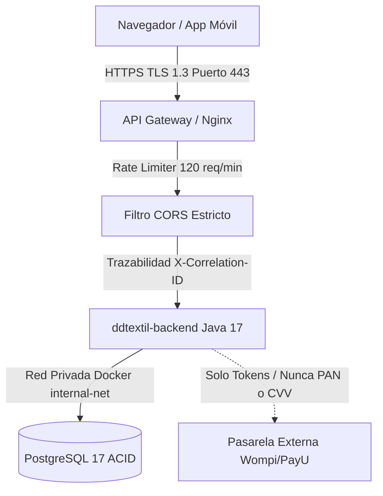

# 07. Estándares Internacionales de Calidad (ISO/IEC 25010), DevSecOps y Sustentación SENA

Este documento consolida el marco técnico y normativo con el cual el **SENA (Servicio Nacional de Aprendizaje)** evalúa y califica la arquitectura técnica, la seguridad, la resiliencia y el aseguramiento de la calidad de la plataforma **D&D Textil**.

---

## 1. Estándares Internacionales de Calidad (Norma ISO/IEC 25010)

La norma **ISO/IEC 25010** define el modelo para la calidad del producto de software. En el contexto de **D&D Textil**, cada característica se traduce en implementaciones concretas para la venta y gestión de textiles:

| Característica ISO | Aplicación Concreta en D&D Textil | Criterio de Medición y Evidencia |
| :--- | :--- | :--- |
| **Adecuación Funcional** | Venta fraccionada por metros continuos y rollos completos; cálculo algorítmico de metraje por lote y calculadora de confección. | Casos de uso 100% completados sin discrepancia de stock en base de datos. Pruebas automatizadas en `PruebasSeguridadYBugs.java`. |
| **Fiabilidad / Resiliencia** | Tolerancia a fallos: Si el servicio de notificaciones o correo se degrada, el procesamiento de pedidos y pasarela continúa operando. | Patrones *Circuit Breaker* y *Retry*. Manejo de conexiones JDBC con auto-recuperación ante desconexión en `Conexion.java`. |
| **Eficiencia de Desempeño** | Búsqueda y filtrado de telas por tipo (lino, drill, seda, algodón) o color bajo alta concurrencia. | Tiempos de respuesta $p95 < 250\text{ ms}$ apoyados en índices B-Tree en PostgreSQL y pool de ejecución concurrente de 32+ hilos. |
| **Mantenibilidad** | Separación clara de dominios (Domain-Driven Design - DDD) para modificar facturación o pagos sin alterar el catálogo. | Arquitectura Limpia modular (`dominio`, `aplicacion`, `infraestructura`), inversión de dependencias y cobertura de pruebas. |
| **Seguridad** | Confidencialidad de compradores, integridad del pedido contra manipulación de precios y control de acceso RBAC. | Estándar OWASP ASVS, inyección SQL prevenida con `PreparedStatement`, y cumplimiento estricto de la Ley 1581 de 2012 (Habeas Data). |
| **Compatibilidad** | API REST bilingüe (español/inglés) compatible con SPA React, apps móviles Android y pasarelas de pago. | Intercambio estándar JSON bajo UTF-8 con respuestas pre-flight `OPTIONS 204 No Content`. |
| **Usabilidad** | Calculadora de metraje interactiva con margen de seguridad del 10% para confección sin mermas accidentales. | Reducción de reclamos por falta de tela y navegación intuitiva por roles (Cliente, Vendedor, Administrador). |
| **Portabilidad** | Despliegue agnóstico en contenedores Docker y orquestación con Docker Compose / Kubernetes. | Configuración 100% externalizada mediante variables de entorno `.env` (The Twelve-Factor App). |

### Principios Arquitectónicos Implementados

1. **The Twelve-Factor App**:
   * *Contenedores Efímeros*: Imágenes Docker sin estado (`stateless`) que pueden destruirse o recrearse instantáneamente.
   * *Configuración Inyectada*: Credenciales de base de datos (`DB_USER`, `DB_PASSWORD`), URLs y puertos se leen de variables de entorno, jamás escritas en código fuente.
   * *Recursos Adjuntos (Backing Services)*: PostgreSQL y pasarelas de pago se tratan como recursos conectados por red desacoplados.

2. **Base de Datos por Servicio (Database-per-Service)**:
   * Cada dominio conserva fronteras transaccionales autónomas. El catálogo de telas no accede directamente a tablas de credenciales de usuario; la comunicación inter-módulo se realiza mediante contratos e interfaces abstractas.

3. **Clean Architecture y Principios SOLID**:
   * **Controladores (`infraestructura/api/manejadores`)** $\rightarrow$ **Casos de Uso (`aplicacion/servicios`)** $\rightarrow$ **Entidades y Contratos (`dominio/modelos` y `dominio/repositorios`)**.
   * Dependencia en una sola dirección hacia el núcleo de negocio. Inyección manual de dependencias en `ServidorApi.java`.

---

## 2. Estrategia de Pruebas y Aseguramiento de Calidad (QA)

Para la sustentación en el SENA, la estrategia de pruebas se estructura bajo la **Pirámide de Pruebas**:

```text
               / \
              / E2E \           -> Playwright / Cypress
             /-------\             (Flujo completo: Login -> Calculadora Metraje -> Carrito -> Pedido)
            / Contract\         -> Esquemas OpenAPI / JSON Schema
           /-----------\           (Validación de contratos REST entre React y Vanilla Java)
          / Integración \       -> Pruebas JDBC contra PostgreSQL en contenedor
         /---------------\         (Transacciones, Rollback de pedidos y Bloqueos pesimistas)
        /    Unitarias    \     -> JUnit / PruebasSeguridadYBugs.java
       /-------------------\       (Cálculo de metros, descuento de cupones, hash criptográfico)
```

### Métricas de Calidad Estática (SonarQube / SAST)

* **Cobertura de Pruebas**: Mantener entre el **70% y el 80%** en componentes críticos de lógica de negocio y seguridad.
* **Deuda Técnica**: Clasificación **Grado A** (índice de remediación de código inferior al 5%).
* **Severidad de Vulnerabilidades**: **Cero vulnerabilidades críticas o bloqueantes (0 Blockers)** bajo el análisis estático de seguridad de SonarQube / SpotBugs.

### Suite Automatizada de Pruebas en el Repositorio (`PruebasSeguridadYBugs.java`)

El proyecto incluye una suite ejecutable con **12 pruebas automatizadas** que validan los criterios de calidad y seguridad:

1. `Hash Criptográfico UTF-8 consistente con caracteres especiales` (SHA-256 determinista).
2. `Deserialización y Sincronización de Bug Reports` (title, area, severity, priority).
3. `Prevención Estricta de Path Traversal en Archivos Estáticos` (bloqueo de `../` y escapes de disco).
4. `Resistencia a Inyección SQL (SQLi)` en autenticación y rechazo de campos nulos/en blanco.
5. `Validación de Rutas y Extracción Segura de Identificadores Numéricos`.
6. `Modelo de Usuario y Compatibilidad Bilingüe en Rol y Estado`.
7. `Observabilidad: Generación y Validación de Formato Correlation ID (UUID v4)`.
8. `Endpoints de Salud y Probes de Observabilidad (/health/live y /health/ready)`.
9. `Control de Concurrencia Textil: Bloqueo Pesimista (SELECT ... FOR UPDATE)` y prevención de condiciones de carrera en reserva de metros fraccionados.
10. `Cumplimiento Normativo Habeas Data (Ley 1581 de 2012 de Colombia)`.
11. `Seguridad y Cumplimiento PCI-DSS: Detección y Rechazo de PAN / CVV`.
12. `Trazabilidad y Logs Estructurados en Formato JSON (DevSecOps)`.

---

## 3. Arquitectura de Seguridad Integral (DevSecOps)

La seguridad se despliega en capas para proteger los microservicios y datos sensibles:



### 3.1 Perímetro y Red
* **API Gateway / Reverse Proxy**: Punto único de entrada. Ningún contenedor de base de datos expone puertos públicos en producción.
* **CORS Estricto**: Cabecera `Access-Control-Allow-Origin` configurada desde variable de entorno hacia el dominio oficial del frontend.
* **Rate Limiting & Throttling**: Límite de **120 peticiones por minuto por IP** implementado en `ManejadorBase.java` con respuesta HTTP 429 para frenar ataques de fuerza bruta contra login y scraping masivo de telas.

### 3.2 Autenticación y Autorización
* **Tokens y Firmas Criptográficas**: Validación de credenciales con hashing unidireccional y emisión de contexto de sesión sanitizado.
* **Propagación de Identidad**: Cabeceras internas seguras (`X-User-Id`, `X-User-Roles`).
* **Matriz de Control de Acceso Basado en Roles (RBAC)**:
  * **Cliente**: Explorar catálogo, usar calculadora de metraje, crear pedidos propios y abrir tickets de soporte.
  * **Vendedor**: Gestionar inventario propio, registrar mermas de tela y consultar pedidos de sus productos.
  * **Administrador**: Moderación de telas, auditoría de usuarios, reportes de analíticas ERP y configuración global.

### 3.3 Seguridad Interna y Zero Trust
* **Redes Aisladas en Docker**: Los contenedores operan en la red interna tipo bridge `ddtextil-net`.
* **Protección contra BOLA (Broken Object Level Authorization)**: Al consultar o actualizar pedidos (`/api/pedidos/{id}`), el backend verifica que el registro pertenezca al usuario autenticado en la sesión, impidiendo que un cliente acceda a facturas ajenas alterando el identificador numérico.
* **Inyección SQL Mitigada**: 100% de las consultas utilizan `PreparedStatement` con parámetros tipados; cero concatenación de cadenas SQL.
* **Gestión de Secretos**: Archivo `.env` excluido del control de versiones mediante `.gitignore`.

---

## 4. Requisitos de Comercio Electrónico y Normativa

### 4.1 Pasarela de Pagos y Cumplimiento PCI-DSS
* **Regla de Oro PCI-DSS**: El backend de **D&D Textil jamás almacena números de tarjeta (PAN), fechas de vencimiento ni códigos de seguridad CVV**.
* **Flujo de Tokenización**:
  1. El comprador ingresa su tarjeta directamente en el formulario seguro del SDK de la pasarela (Wompi / PayU / Stripe).
  2. La pasarela genera un token transaccional efímero (`token_id`).
  3. El frontend envía dicho token al backend en `/api/pedidos` o `/api/invoices`.
  4. El backend valida el token con el método `contieneDatosTarjetaSensibles()`, garantizando que ninguna información sensible toque los logs ni la base de datos PostgreSQL.

### 4.2 Ley de Habeas Data (Ley 1581 de 2012 - Colombia)
* **Consentimiento Previo y Expreso**: El formulario de registro exige la confirmación activa (`aceptaHabeasData = true`) con un checkbox no premarcado.
* **Validación en Dominio**: `ServicioAutenticacion.registrarCliente()` rechaza cualquier registro que intente omitir la aceptación legal, arrojando `ExcepcionDominio`.
* **Derechos ARCO**: Endpoints y procesos administrativos para consulta, rectificación y eliminación (derecho al olvido) de datos personales.

### 4.3 Control de Concurrencia en Inventario Textil (Race Conditions)
* **El Problema Textil**: La venta de telas es fraccionada (ej. 3.5 metros). Si dos compradores intentan adquirir los últimos 5 metros de un rollo simultáneamente, se produce una **condición de carrera** que puede generar sobreventa e inventario negativo.
* **La Solución (Bloqueo Pesimista)**:
  En `PedidoDAO.java`, la transacción de compra ejecuta:
  ```sql
  SELECT id, stock, nombre FROM productos WHERE id = ? FOR UPDATE;
  ```
  PostgreSQL adquiere un bloqueo exclusivo a nivel de fila (*Row-Level Exclusive Lock*). La segunda transacción se encola en milisegundos hasta que la primera confirma (`COMMIT`) o revierte (`ROLLBACK`). Si el stock resultante es insuficiente, se aborta la transacción limpiamente.

---

## 5. Observabilidad y Monitoreo

Para asegurar auditabilidad técnica ante el comité de evaluación del SENA:

### 5.1 Correlation ID (Trace ID)
* Cada solicitud HTTP procesada por `ManejadorBase.java` extrae o genera automáticamente un identificador único:
  ```http
  X-Correlation-ID: e7a1b8c4-89f2-4a1e-b6d3-1289fe402a5c
  ```
* Se devuelve en las cabeceras de respuesta y se propaga en los registros de auditoría.

### 5.2 Endpoints de Salud (Health Checks)
Disponibles de forma nativa para Kubernetes, Docker o dashboards de monitoreo:
* **`GET /health/live`**: Liveness probe. Verifica que el proceso Java está ejecutándose y reporta memoria JVM utilizada, libre y total.
* **`GET /health/ready`**: Readiness probe. Valida el socket activo y la conectividad JDBC con PostgreSQL mediante `Connection.isValid(2)`. Devuelve código HTTP 200 (UP) o HTTP 503 (DOWN).
* **`GET /api/health`**: Reporte consolidado de salud del sistema.

### 5.3 Logs Estructurados en JSON
El servidor emite eventos estructurados en formato JSON estándar para ingestión directa en ElasticSearch, Graylog o Grafana Loki:

```json
{
  "timestamp": "2026-10-13T22:30:15.120Z",
  "level": "INFO",
  "service_name": "ddtextil-backend",
  "trace_id": "e7a1b8c4-89f2-4a1e-b6d3-1289fe402a5c",
  "method": "POST",
  "path": "/api/orders",
  "status": 201,
  "message": "Petición procesada exitosamente en 18 ms"
}
```

---

## 6. Guía Rápida de Sustentación para Instructores del SENA

### Comandos de Demostración en Vivo

1. **Ejecutar la suite de pruebas de seguridad y concurrencia**:
   ```bash
   cd "tienda digital de telas/backend-java/conexionPostgres"
   java -cp "lib/*;src" PruebasSeguridadYBugs
   ```
   *Evidencia*: 12 de 12 pruebas aprobadas con cero fallos.

2. **Verificar el estado del Health Check (Liveness Probe)**:
   ```bash
   curl -i http://localhost:8081/health/live
   ```
   *Respuesta*: HTTP 200 con JSON de estado `UP` y métricas de memoria.

3. **Verificar la conectividad a Base de Datos (Readiness Probe)**:
   ```bash
   curl -i http://localhost:8081/health/ready
   ```
   *Respuesta*: HTTP 200 con verificación de PostgreSQL.

4. **Verificar trazabilidad de Correlation ID**:
   ```bash
   curl -i -H "X-Correlation-ID: sena-test-trace-123" http://localhost:8081/api/products
   ```
   *Respuesta*: Cabecera HTTP `X-Correlation-ID: sena-test-trace-123` reflejada en la respuesta.
